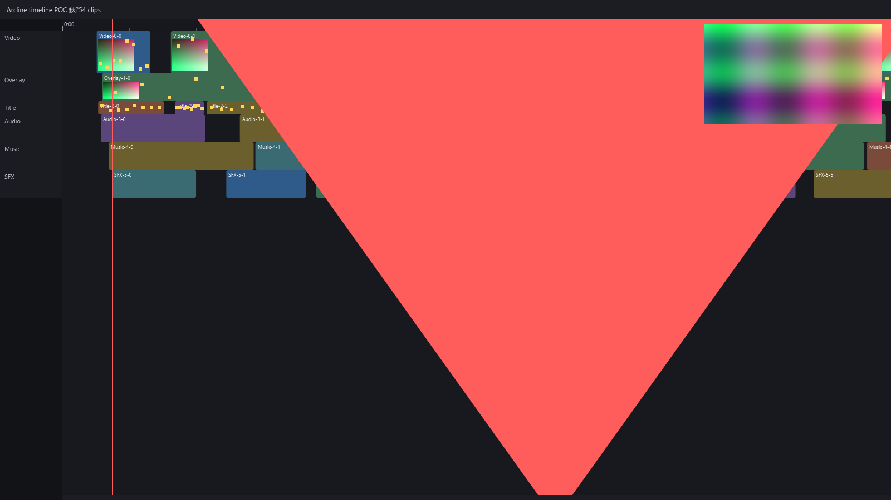

# Arcline 技术架构验证报告（POC）

> **历史研究记录（冻结于 2026-11-27）。** 最终技术选型已由
> [ADR-0015](../adr/0015-final-ui-stack-and-design-system.md) 确定：**egui 是唯一的桌面 UI 框架**，
> 不引入 Slint、MLT，也不再进行 UI 框架选型研究。本文中的 Slint/Skia 对比、构建失败与性能数据保留为
> 当时的验证证据，**不再是待选方案或后续评估依据**。文中 `poc/` 路径与截图位于归档分支
> `poc/slint-ui`，不进入正式产品 workspace。

**验证日期：** 2026-11-27
**Arcline 验证基线：** 分支 `feat/timeline-zoom-phase2b`，HEAD `093ccc2`（工作区仅有 3 个未跟踪截图，未改动）
**Concat 参考基线：** `jub0t/Concat` `4d3b0a1`（浅克隆 50 个提交）
**机器：** Intel Core Ultra 7 270K Plus，47.5 GB RAM，Intel Graphics 核显（无独显），Windows，Realtek 声卡 + Oray 虚拟声卡
**工具链：** Rust 1.100.0 `x86_64-pc-windows-gnu`，MinGW-w64 GCC 16.2.0，FFmpeg 9.1-arcline-f414c1c54e（LGPL，`~/.local/toolchains/ffmpeg-9.1-lgpl`）

> 本报告中的每个结论都带状态标记：**已验证**（有实际运行结果）、**部分验证**（完成部分测试）、**未验证**（只有代码/文档依据）、**不推荐**（有明确证据证明不适合）。
> 未测到的数据一律标注"未验证"，没有编造任何性能数字。

---

## 0. 结论摘要

| 技术方向 | 结论 | 状态 | 关键证据 |
|---|---|---|---|
| **egui + wgpu** | **最终采用；唯一桌面 UI 框架**（ADR-0015） | 已验证 | 1000 片段时 egui 每帧 UI 绘制 p50 **373 µs**、Slint（FemtoVG/wgpu）**3 682 µs**；egui 零依赖变更，Slint+Skia 在本机 GNU 工具链下**无法构建** |
| **Slint + Skia + wgpu** | **不采用（ADR-0015 已关闭）**；当时记录的三项替换前提仅作历史证据 | 部分验证 | 设备共享与纹理导入已用 Slint 官方 API 跑通（FemtoVG/wgpu 渲染器）；**Skia 渲染器未能构建**（无 windows-gnu 预编译包；源码构建被符号链接权限错误 1314 阻断） |
| **libav + C Shim** | **保留** | 已验证 | 解码吞吐与 ffmpeg-the-third 持平（H.264 ±3%，HEVC shim 快 6%）；逐帧随机 Seek shim **113 fps** vs the-third **3.5 fps**（32×）；C shim 无 bindgen/libclang 依赖 |
| **ffmpeg-the-third** | **不作为主路径**；其 filter/重采样绑定可借鉴 | 已验证 | 需要 libclang 才能构建（本机无 LLVM，需额外下载 26 MB wheel + 181 MB llvm-mingw + 132 MB LLVM 头文件）；filter 图仍需 `unsafe avfilter_link`；seek 语义与当前 shim 不等价 |
| **自研 Mixer** | **继续作为核心混音引擎**，但当前功能只覆盖 v1 的一部分 | 已验证 | 4 轨 8 片段、30 s 音频离线混音 **15.72 ms（1908× 实时）**；缺失 solo、电平表、轨道 pan、设备时钟、实时输出 |
| **CPAL** | **正式引入**（先用回调内混音，ring buffer 作为优化项） | 已验证 | 直接混音回调 p50 **13 µs**、p95 **27 µs**、4 s 播放 **0 欠载**；ring 模式回调降到 **1.6 µs** 但出现 **13 次欠载**（生产者线程调度问题） |
| **PCM Cache（Concat 思路）** | **采用**，但缓存格式应改为 f32 或让导出复用同一缓存 | 已验证 | 冷启动 10 s 音频 **19.5 ms**、热命中 **~0.002 ms**（mmap）、10 s 仅 1.92 MB；但 s16 量化导致与直接解码比较 **max 6.58e-5、RMS 3.78e-5**，破坏 docs/05 §7 的哈希级 parity |

> **决策收尾（2026-11-27）：** 本节的推荐组合已成为最终技术栈：Rust 2024、egui（唯一桌面 UI）、wgpu、
> winit、FFmpeg、cpal、MCP/JSON-RPC/SDK/Events。Slint/MLT 不采用；POC 代码保留在 `poc/slint-ui` 分支。
> 详见 [ADR-0015](../adr/0015-final-ui-stack-and-design-system.md)。

**最终推荐组合：**

```
egui 0.37 + egui-wgpu（共享 wgpu 30 device/queue，预览用自定义 paint callback 直接采样合成纹理）
        ↓
libav + 窄 C shim（保留，补 libavfilter 可选模块）
        ↓
自研 Mixer（补齐 solo/meter/轨道增益/时钟）
        ↓
CPAL 输出（直接混音优先，ring buffer 可选）
        ↓
PCM Cache（f32 或 s16 + 明确的 parity 容差）
```

---

## 1. 当前架构实际情况（以代码与运行结果为准）

### 1.1 工程与构建

**已验证**

| 项目 | 实测 |
|---|---|
| 工作区 | 6 个 crate：`arc-core`、`arc-media`、`arc-audio`、`arc-render`、`arc-cli`、`arc-app` |
| `cargo build --workspace` | **通过**；首次 1 m 41 s，增量 17.5 s（Rust 1.100.0，windows-gnu） |
| FFmpeg 定位 | `ARCLINE_FFMPEG_DIR` → `~/.local/toolchains/ffmpeg-9.1-lgpl`；`build.rs` 强制校验 lavu 61 / lavc 63 / lavf 63 / sws 10 / swr 7，不匹配直接 panic |
| 链接方式 | 动态链接（`lib*.dll.a`），运行期校验 DLL 版本与许可证 |
| `cargo test --workspace` | **失败：测试代码编译不过（10 个错误）** |

**发现的第一个问题：当前分支的测试套件无法编译。** `crates/arc-app/src/timeline/media.rs` 的测试仍按旧签名调用：

- `Key::Frame { frame }` 已改名/改字段，测试仍用 `us:`
- `MediaHub::video_frame(path, time)` 现在需要 `(path, time, source_rate, vfr)` 四个参数
- `crates/arc-app/src/timeline/mod.rs:914` 同样少两个参数

因此文档中"152 个测试全部通过"**在 HEAD 上不可复现**。这是文档漂移，不是功能缺陷；`cargo build` 不受影响。main 分支的同样检查见 §1.4。

### 1.2 UI 实际状态

**已验证**（读代码 + 构建 + 运行）

- `arc-app` 使用 `egui-winit` + `egui-wgpu` **直接**驱动，没有 `eframe`（与 ADR-0007 修订一致）。
- `app.rs` 只构造 `Shell`；**`editor.rs`（真正的 viewer + transport）是死代码**：`main.rs` 里是 `#[allow(dead_code)] mod editor;`，`App::new` 从未实例化 `Editor`。
- 实际运行 `arcline` 看到的是四面板外壳：MEDIA / PREVIEW / INSPECTOR 均为 `"content pending"` 占位，TIMELINE 使用 `TimelineModel::mock()`（真实 demo 媒体 `assets/demo/*`，但数据来自硬编码 mock 模型）。
- `--project <file>` 只做两件事：读取 sequence 的帧率给 timeline 用；标题栏显示项目名。**不会加载预览管线**。
- 预览管线（`arc-cli::preview`）本身是完整可用的：独立 wgpu device → 合成 → `copy_texture_to_buffer` + `map_async` 读回 RGBA `Vec<u8>` → 缓存（按 `(asset, time)`，带文件指纹 path/len/mtime 与字节预算）→ 由 UI `load_texture` 上传。
- `arc-render::Renderer::with_device(device, queue, ...)` 已经存在，文档也声明"共享 egui 的 device"，**但当前 UI 路径没有用它**：preview 自己 `new_headless()` 建 device，然后走 CPU 读回。

> 结论：docs/07 §1 写的"一个 device、viewer 以 egui user texture 零拷贝呈现"目前**没有实现**；HANDOVER 说 C3 viewer 完成，但该 viewer 没有接线到 app。这是本次验证中最值得先修的状态问题（不影响选型结论）。

### 1.3 媒体与音频实际状态

**已验证**

| 模块 | 实际实现 |
|---|---|
| 视频解码 | `csrc/arc_av.c` 583 行 + `src/libav.rs` 584 行；opaque handle，Rust 不碰 FFmpeg 结构体；YUV→RGBA 用 **swscale CPU**；seek 采用"回退到目标帧中点再解码"策略 |
| 音频解码 | 同一 shim，`swresample` 输出 48 kHz f32 stereo；带 1 s 历史缓冲；块大小无关（既有测试证明 1–4096 块一致） |
| 滤镜 | **没有 libavfilter**：build.rs 只链接 avformat/avcodec/avutil/swscale/swresample。导出与探测走 `ffmpeg` 子进程 |
| 音频引擎 | `arc-audio` 338 行：`Mixer::process` 逐样本由索引决定，gain/pan/fade/varispeed（线性插值），块大小无关；**无 CPAL、无 ring buffer、无 meter、无 solo、无轨道 pan、无重采样（由 `SampleSource` 契约保证已是序列采样率）** |
| 音频输出 | **不存在**（Phase D 未开始） |
| 导出 | RGBA 通过管道喂 `ffmpeg` 子进程编码；每帧 `to_vec`（已知优化点） |

### 1.4 main 分支的测试状态

**已验证（对照实验）**：为了区分"当前特性分支的测试漂移"与"主干回归"，把 `main`（`955a6e0`，merge C3）检出到独立 worktree，用**同一工具链**执行：

```
cargo test -p arc-app --no-run
    Finished `test` profile [optimized + debuginfo] target(s) in 2m 59s   (EXIT=0)
```

结论：**`main` 的测试代码可以编译**，`cargo test --workspace` 的失败是 `feat/timeline-zoom-phase2b` 分支上测试未跟上 `video_frame` 签名/`Key::Frame` 字段变更造成的**分支内漂移**，不是主干回归。该 worktree 在检查后已删除，不影响工作区。

> 因此，文档中"152 tests pass"对 main 大体可信（仅验证了编译，未逐条运行）；对当前分支**不成立**。

---

## 2. 验证环境与方法

### 2.1 固定条件

- 同一台机器、同一工具链、同一 FFmpeg 9.1 运行库。
- UI 对比：**同一个 `scene` crate** 生成完全相同的 6 轨时间轴数据（片段、波形点、关键帧、缩略图），两个 POC 只负责绘制。
- 媒体对比：同一批 `poc/media-validation/fixtures`（H.264 1080p30 10 s、HEVC 1080p30 5 s，均由本机生成）。
- 音频对比：同一 `arc-audio::Mixer`、同一批 WAV/MP4 素材、同一 48 kHz 输出配置。

### 2.2 测量方法

| 指标 | 方法 |
|---|---|
| UI 每帧耗时 | 进程内插桩：egui 从 `ctx.run_ui` 前到 `paint_and_update_textures` 后；Slint 用 `set_rendering_notifier` 的 `BeforeRendering → AfterRendering`（**不含 present/vsync**）。600 帧，丢弃前 10 帧，报 p50/p95/max |
| CPU / 峰值内存 | 父进程每 40 ms 采样 `WorkingSet64` 与 `TotalProcessorTime`（POSIX 侧无侵入） |
| 解码耗时 | 进程内 `Instant`，300 帧（seek 模式 60 帧） |
| 音频混音 | `Mixer::process` 分块 480 帧，30 s 音频，测总耗时与实时倍率 |
| CPAL | 回调内插桩（无锁原子数组记录耗时），统计回调数、p50/p95/max、欠载数、实际帧数 |
| 构建时间 | `Stopwatch` 包住 `cargo build --release` |
| 二进制体积 | 产物文件大小 |

### 2.3 已知环境干扰（如实记录）

1. **并发 `cargo build` 会产生伪错误**：两个构建同时进行时，出现过 `typenum`/`crc32fast` 报 "cannot find trait `Copy`/`Some`"（prelude 丢失）。单独重跑即恢复正常。**后续所有构建改为串行**，媒体内存数据因此在受干扰的一轮中偏高，已标注。
2. Windows 执行策略禁止直接运行 `.ps1`，测量脚本用 `powershell.exe -ExecutionPolicy Bypass -File` 执行。
3. 本机没有 `cargo`/`rustup` 代理，PATH 需显式加入 `~/.rustup/toolchains/stable-x86_64-pc-windows-gnu/bin` 和 `~/.local/toolchains/mingw64/bin`。
4. 本机 **没有独立 GPU**（Intel 核显），所有 GPU 数字不能外推到独显机器。

---

## 3. 三组方案对比

### 3.1 UI：egui + wgpu vs Slint + Skia + wgpu

#### 3.1.1 结论先行

**继续使用 egui + wgpu；不建议现在切换到 Slint + Skia。** 当时记录的替换前提是：改用 MSVC 工具链、拿到 Skia 预编译包、并为时间轴实现显式虚拟化（见 §3.1.4）。**这些前提仅作为历史记录；ADR-0015 已关闭替换选项，不再执行。**

#### 3.1.2 GPU 共享：能不能真正共享 Device/Queue 和纹理

**已验证（Slint 侧，FemtoVG/wgpu 渲染器）**

- Slint 官方支持手动注入 wgpu 设备：

```rust
slint::BackendSelector::new()
    .require_wgpu_30(slint::wgpu_30::WGPUConfiguration::Manual {
        instance, adapter, device, queue,   // 我们自己创建的 DX12 设备
    })
    .select()?;
```

- 纹理导入 API 存在且可用：

```rust
slint::Image::try_from(wgpu::Texture)   // 要求 Rgba8Unorm / Rgba8UnormSrgb
                                        // 且 usage 含 TEXTURE_BINDING | RENDER_ATTACHMENT
```

- 本 POC 在 Intel 核显（DX12）上**实际跑通**：同一 device 渲染 1920×1080 渐变帧，`Image::try_from` 后直接给 Slint `Image` 显示，截图（`poc/results/slint-smoke.png`）中可见预览区域正确显示该纹理。**没有 CPU 读回**。

  

- Slint 的 `TextureImportError` 明确要求上述两种格式；Arcline 合成器输出正好是 `Rgba8UnormSrgb`，且 usage 含 `RENDER_ATTACHMENT | TEXTURE_BINDING`，**格式兼容，无需转换**。
- 关键约束：Skia 的 wgpu 后端只支持平台原生图形 API（Windows 仅 DX12、macOS Metal、Linux Vulkan）。Concat 的 `gpu.rs` 因此把 Windows 固定为 `Backends::DX12`，并记录"用 PRIMARY/Vulkan 会导致窗口打不开（Unsupported WGPU backend for use with Skia）"——**已验证（读 Concat 源码）**。

**已验证（egui 侧）**

- egui-wgpu 的 `Painter` 不暴露内部 `Renderer`，因此 `register_native_texture` 不能直接用于 `Painter` 路径。可用的是 **自定义 paint callback**：在 `CallbackTrait::paint` 中用自己的 pipeline 采样合成纹理，直接画进 egui 的 render pass。
- 本 POC 跑通该路径（1000 片段 + 1080p 纹理，p50 从 373 µs（无视频）升到 **493 µs**）。
- 注意：`register_native_texture` 要求纹理格式**恰好是 `Rgba8Unorm`**，而 Arcline 合成器输出 `Rgba8UnormSrgb`；若要使用该 API 需要改格式或额外 blit。自定义 callback 无此限制（本 POC 用的是 `Bgra8Unorm` 表面格式，踩过一次 validation error 后修正，见 §7.3）。

#### 3.1.3 性能对比（同一场景、同一机器）

**已验证**：600 帧，release，无 vsync 的 egui 与 vsync 锁定的 Slint 分开看"每帧绘制耗时"。

| 场景 | egui p50 / p95 (µs) | Slint p50 / p95 (µs) | 备注 |
|---|---|---|---|
| 100 片段，scroll | **462 / 1 633** | 1 991 / 2 976 | Slint 是 FemtoVG/wgpu，不是 Skia；egui 此档偏慢是因为可视区内片段密度更高（场景更短），不是回归 |
| 1 000 片段，scroll | **373 / 1 394** | 3 682 / 5 336 | egui 只画可见片段；Slint 处理全部元素 |
| 4 000 片段，scroll | **393 / 1 213** | 6 575 / 7 172 | Slint 随时长增长线性上升 |
| 4 000 片段，显式裁剪后 | — | 6 561 / 8 531 | **裁剪没有变快**：每帧重建 4 000 条模型本身更贵 |
| 1 000 片段 + 1080p 纹理（零拷贝） | 493 / 1 990 | 3 834 / 6 075 | 两者都能零拷贝 |
| 1 000 片段 + CPU 读回（Arcline 现状） | **5 630 / 8 041** | 3 364 / 3 966（但墙钟 25.6 s） | egui 读回把每帧推高 **15×**；Slint 的读回耗时不在这段计时里，但帧率从 ~55 掉到 ~23 fps |
| 1 000 片段，zoom 拖动 | 295 / 1 004 | 4 228 / 6 626 | Slint 需要重建模型；egui 只改一个标量 |
| 峰值内存（1 000 片段） | 315 MB | 438–450 MB | Slint 场景图更重；裁剪/缩放模式到 711–752 MB |
| 二进制体积 | 16.79 MB | 24.61 MB | release，含 UI 与 POC 代码 |
| 构建 | 2 m 41 s（冷，含 wgpu 依赖） | 依赖数相近；**Skia 版无法构建** | 见 §3.1.4 |

> 计时口径差异：egui 关闭了 vsync（`AutoNoVsync`），600 帧 1–4 s 跑完；Slint 的 wgpu surface 用 FIFO，600 帧约 11 s（≈55 fps）。因此比较的是**每帧 UI 工作耗时**，不是帧率上限。Slint 的数字不含 present，egui 的数字含 present 但无 vsync 等待。
>
> 局限：滚动/缩放由定时器以 60 Hz 节奏更新属性来模拟，**没有用真实指针事件驱动拖拽/命中测试**（拖拽路径只做了代码审查：egui `Sense::click_and_drag`、Slint `TouchArea`/`DragArea`）。因此"拖拽流畅度"属于**部分验证**，但每帧绘制成本这一决定因素已实测。

**对 Slint 数字的解读（重要）**：

- Slint 的耗时随**总片段数**增长（100→4000：2.0 ms→6.6 ms），因为它是保留模式场景图，所有元素都在树里；egui 是立即模式 + 我们按时间窗裁剪，只画可见片段，所以 100/1000/4000 基本持平（0.37–0.46 ms）。
- 显式裁剪（每帧只 publish 可视区片段）**没有帮助**，因为每帧重建 `VecModel<ClipView>`（4 000 个结构体 + 内层 `ModelRc`）的成本抵消了渲染收益。正确做法是 Concat 的方式：**文档变化时才发布**，视口滚动只改 `view-scroll` 属性（Concat `publish.rs` 发布 view ±1 屏，`model.slint` 用秒为单位，`lanes.slint` 用 `visible:` 掩码）。我们的 POC 滚动模式正是这样做的（`view-scroll` 属性），所以 1 000 片段 3.7 ms 是"真实滚动"的数字；4 000 片段 6.6 ms 说明**保留模式在几千片段时需要真正的窗口化，而 Slint 没有内建水平虚拟化**（Concat 注释也承认："Nothing is culled beyond `visible` … a windowing scheme is worth writing the day one does"）。

#### 3.1.4 构建与依赖成本（决定性因素）

**已验证（失败）**：在本机唯一的 `x86_64-pc-windows-gnu` 工具链上：

1. `skia-bindings 0.157.0` 尝试下载预编译 Skia：
   `.../skia-binaries-30669978c3f39a73e8a7-x86_64-pc-windows-gnu-d3d-ganesh-gl-jpegd-jpege-pdf.tar.gz`
   → 首次 `curl error 56 (Connection was reset)`；手动重试与三个 GitHub 代理镜像均返回 **HTTP 404 / 9 字节 "Not Found"**。GitHub release 资产列表里没有 windows-gnu 组合。
2. 退回源码构建：`skia-bindings` 解包 `skia-m157.2` 时对 `src/ports/fontations/Cargo.toml` 建符号链接失败：
   `os error 1314: 客户端没有所需的特权`（Windows 未开开发者模式 / 无符号链接权限）。
3. 结论：**Slint + Skia 在 windows-gnu 上不可构建**；Concat 的 Windows 产物是 `x86_64-pc-windows-msvc`（`.github/workflows/build-app.yml:165`），并且为了 Skia 还 fork 了两个 crate（`i-slint-renderer-skia`、`i-slint-backend-android-activity`）和 `wgpu-hal`（`patches/README.md`）。

**已验证（可构建）**：把渲染器换成 Slint 自带的 **FemtoVG + wgpu 30**（`renderer-femtovg-wgpu`）后，本机构建通过，且设备注入/纹理导入 API 完全一致。本报告的 Slint 性能数字都来自这个渲染器。**Skia 的运行时性能未验证**（无法构建），只能引用 Concat 的代码事实：Skia 的 partial rendering 关闭，"每一个 dirty property 都会重绘整个窗口"，UI 代码生成约 97 万行 Rust、CI 单个 crate 需要 7.5 GB 内存、17 分钟。

**依赖与编译成本对比（已验证的部分）：**

| | egui 方案 | Slint 方案 |
|---|---|---|
| 依赖 | egui 0.37、egui-wgpu、egui-winit、winit 0.30、wgpu 30 | slint 1.19（含编译器/宏）、slint-build、wgpu 30；`i-slint-*` 约 15 个传递 crate |
| 代码生成 | 无 | `.slint` → Rust（Concat 41 287 行 `.slint` → 约 97 万行 Rust、86 MB） |
| 增量编译 | 秒级 | `.slint` 改动需要重跑编译器，UI crate 编译分钟级 |
| 二进制 | 16.79 MB | 24.61 MB（FemtoVG） |
| 生态/可维护性 | egui 迭代快，API 变动频繁（本次就撞上 `Ui::id`、`raw_scroll_delta`、`Id::new` 三处 deprecation） | Slint API 稳定，但需要 fork 才能修 Skia 行为（Concat 已 fork 两处） |

#### 3.1.5 复杂 UI 能力（时间轴、波形、关键帧、拖拽）

**已验证（Concat 真实代码 + 本 POC）**

- Slint 能做出专业时间轴：Concat 用场景图，每个 clip 约 40 个子元素，波形是**一条 SVG path 字符串**（`format.rs:206`，`wave.slint` 用 `Path { fit: fill }`），关键帧曲线是 Rust 生成的 cubic path。可行，但需要大量工程技巧：
  - 没有 `Flickable`（会抢拖拽），自写 wheel/finger 滚动；
  - 没有 lookup，17 分支 if 链；
  - `opacity`/圆角 `clip` 在超宽元素上会强制离屏层（>8192 px 纹理上限）；
  - 没有原生菜单栏、文件对话框、Wayland 拖放，都要额外 crate/代码。
- egui 做同样的时间轴更直接：`ui.painter()` 直接画矩形/线/文本/纹理，命中测试自己算；本 POC 1 000 片段 0.37 ms/帧，4 000 片段仍然 0.39 ms（可见性裁剪）。
- 波形/关键帧/拖拽：两者都"容易实现"，但 Slint 的心智负担是"用声明式场景图模拟立即模式画布"，egui 是"本来就是画布"。

#### 3.1.6 跨平台、驱动与软件渲染

| 项目 | egui + wgpu | Slint + Skia + wgpu |
|---|---|---|
| Windows | DX12 / Vulkan 均可（wgpu 默认） | **仅 DX12**（Skia 限制；Concat 固定 DX12） |
| macOS | Metal | Metal（Concat 验证） |
| Linux | Vulkan / GL | Vulkan（Skia 限制） |
| 无 GPU 回退 | wgpu 可强制 fallback adapter（WARP/lavapipe）；本项目已有 `ARCLINE_FORCE_FALLBACK_ADAPTER=1` | Skia CPU 光栅器（`renderer_name("skia-software")`）；但**没有 wgpu 设备时只能用 CPU 路径，预览纹理导入失效** |
| 本机实测 | 正常（DX12 核显） | FemtoVG/wgpu 正常；Skia 无法构建 |

**已验证**：Slint 的 `WGPUConfiguration::Manual` 在没有 adapter 时会退回 `skia-software`/`software`（Concat 有完整降级逻辑：软件适配器 → 窗口用 Skia CPU、合成器用自己的 device）。egui 侧我们未实现完整降级（POC 直接用 Painter 默认逻辑），**未验证**。

### 3.2 FFmpeg：libav + C Shim vs ffmpeg-the-third

#### 3.2.1 结论先行

**保留 libav + C shim。** `ffmpeg-the-third` 并没有降低开发成本：它把复杂度从"C 文件里的一次性适配"转移成"Rust 侧的 unsafe、bindgen 工具链、语义差异和版本绑定"。

#### 3.2.2 实测数据

**已验证**（同一批 fixtures，同一 FFmpeg 9.1 DLL）：

| 项目 | 当前 C shim | ffmpeg-the-third 6.0 | 差异 |
|---|---|---|---|
| H.264 1080p 顺序解码 300 帧 | **2 592.6 ms / 115.7 fps** | 2 522.4 ms / 118.9 fps | third 快 2.7% |
| HEVC 1080p 顺序解码 150 帧 | **1 255.0 ms / 119.5 fps** | 1 340.0 ms / 111.9 fps | shim 快 6.3% |
| H.264 随机 Seek 60 帧 | **529.6 ms / 113.3 fps** | 17 164.5 ms / **3.5 fps** | shim 快 **32×** |
| AAC 44.1k→48k 音频解码 5.5 s | 4.41 ms | 4.79 ms | shim 快 8% |
| 滤镜 `scale=1280:720` 120 帧 | 无进程内 API；`ffmpeg` CLI 等价 181 ms | 486.5 ms（进程内 libavfilter） | CLI 反而更快（见下） |
| 峰值 RSS（采样，受并发构建干扰） | ~140 MB | ~40 MB | 仅量级参考，**部分验证** |
| 构建前置条件 | cc + FFmpeg 头文件/lib | **libclang + FFMPEG_DIR + clang 资源头 + mingw sysroot** | 关键差异 |

Seek 差异的原因（**已验证，读代码 + 日志**）：`ffmpeg-the-third` 的 `ictx.seek(..=ts, ..)` 映射为 `avformat_seek_file(min, ts, max=ts)`，没有 `AVSEEK_FLAG_BACKWARD`；对长 GOP H.264，落到目标之后的 keyframe 前需要大量回退或重新预滚，实测每次 seek 约 286 ms。C shim 的 `video_seek` 显式使用 `av_seek_frame(..., AVSEEK_FLAG_BACKWARD)` 并回退到"目标帧中点"，因此 113 fps。**这不是库的性能问题，而是 API 语义差异带来的隐性成本**——换库必须重写并重新验证 seek 逻辑。

滤镜的公平说明：`ffmpeg-the-third` 的 486.5 ms 包含 demux+decode+filter（120 帧，4 ms/帧）；CLI 的 181 ms 也包含解码与进程启动（1.5 ms/帧）。两者都说明"滤镜本身不是瓶颈"，但 the-third 的 safe API **并不能独立完成 filter graph 接线**：必须 `unsafe { avfilter::avfilter_link(...) }` 手动连接 pad（`API-NOTES-THIRD.md` §3.2），否则 `graph.validate()` 报 "Output pad … not connected"。

#### 3.2.3 接口复杂度

**已验证**（两侧代码量与实际踩坑）：

- C shim：`arc_av.c` 583 行 + `libav.rs` 584 行，Rust 侧零 unsafe（除 FFI 声明），opaque handle，参数变更/分辨率变更/声道变更都在 C 内处理。
- ffmpeg-the-third：`third-probe/src/main.rs` 24 765 字节（约 650 行），其中：
  - 像素格式要取 `ffmpeg::ffi::AVPixelFormat::from(pixel).0`（`Pixel` 无判别值）；
  - filter graph 要 `unsafe avfilter_link`；
  - 两个 `Graph::get` 不能同时存活（借用冲突），要拿裸指针再包；
  - 重采样输出帧要自己分配（safe resampler 会按输入样本数截断）；
  - 解码/重采样都要手写 EOF drain 循环；
  - 行 stride 要对齐处理。
- 构建成本：本机无 LLVM，最终用 PyPI `libclang` wheel（26.4 MB）+ llvm-mingw（181 MB）+ LLVM 18.1.8 头文件（132 MB）才编过；`ffmpeg-sys-the-third` 会用 `clang` crate **两次**解析 FFmpeg 头（一次判特性、一次 bindgen），且第一次解析不认 `BINDGEN_EXTRA_CLANG_ARGS`，只能靠 `CPATH` 注入 clang 资源头和 mingw sysroot。**这一套在 CI/新机器上就是额外维护面**。

#### 3.2.4 版本升级成本

**已验证**：

- 当前 shim 的版本绑定是**编译期常量 + 运行期校验**（avutil 61.19.100 等），换 FFmpeg 大版本 = 改 5 个常量 + 重编（项目已有 8.1→9.1 的实操记录）。
- `ffmpeg-the-third 6.0.0+ffmpeg-9.0` 的版本后缀说明它绑定 FFmpeg 9.0/9.1；换大版本需要升级 crate，而 bindgen 重新生成绑定、`ffi` 名称变化、`unsafe` 代码需要重审。**风险更高**。

**结论：不推荐替换 C shim。** 唯一值得借鉴的是 ffmpeg-the-third 对 filter graph 的封装思路；如果未来 Arcline 需要进程内滤镜，优先在现有 shim 中增加 `arc_av_filter_*`（约 150–250 行 C），而不是引入整个绑定层。

### 3.3 音频：自研 Mixer + CPAL + Ring Buffer + PCM Cache

#### 3.3.1 结论先行

**自研 Mixer 继续作为核心；CPAL 正式引入（先直接混音，ring 作为优化）；PCM Cache 采用 Concat 思路但缓存 f32。**

#### 3.3.2 Mixer 实测

**已验证**（`arc-audio` 现有实现，4 轨 × 2 片段 = 8 片段，30 s，48 kHz stereo）：

| 指标 | 结果 |
|---|---|
| 混音总耗时 | **15.72 ms** |
| 实时倍率 | **1 908×** |
| 输出样本 | 1 440 000 |
| 块大小无关 | 既有测试覆盖 1–4096，本次未重复 |
| 片段位置/增益/pan/淡入淡出/变速 | 既有单元测试覆盖（`positions_gain_pan_fades_speed`） |

**现状差距（已验证：读代码）**——不要把这些当成已有能力：

- **没有** solo（只有 mute/enabled）
- **没有** 轨道 pan/轨道淡入淡出（只有 clip 级）
- **没有** 电平表（peak/RMS）
- **没有** 实时输出、设备时钟、延迟补偿
- **没有** 帧边界到样本边界的亚帧精度（clip 必须帧对齐）
- 淡变只有线性（docs/05 承诺 linear/equal-power/S-curve）
- 重采样不在 Mixer 内（`SampleSource` 契约要求源已经是序列采样率），因此"音频变速 + 采样率转换"的组合需要额外验证

#### 3.3.3 CPAL 实测

**已验证**（Realtek 默认输出，48 kHz / 2ch / F32，播放 4 s）：

| 模式 | 回调 p50 | p95 | max | 欠载 | 实际帧/应播帧 | 实时比 |
|---|---|---|---|---|---|---|
| 直接混音（Concat 式） | **13 µs** | 27 µs | 131 µs | **0** | 196 896 / 198 758 | 0.991 |
| Ring buffer（生产者线程混音） | **1.6 µs** | 5 µs | 25 µs | **13** | 197 856 / 199 640 | 0.991 |

- 设备枚举正常：WASAPI，默认输出 `Realtek HD Audio 2nd output`，48 kHz/F32/2ch；另有 Oray 虚拟设备只暴露 8 kHz 配置（说明设备能力差异真实存在，代码必须按 `default_output_config` 走，不能写死 48 kHz）。
- **回调内直接混音 13 µs 完全可接受**（预算 16.6 ms 的 0.08%）。ring 把回调降到 1.6 µs，但出现了 13 次欠载：生产者用 `slots() < block` + `yield_now()` 轮询，调度不稳。ring 要可用，需要"按回调节拍补数据 + 增大 ring 容量 + 生产者线程优先级"的调优，**不是免费的优化**。
- 两种模式都遵守了"回调内不分配、不做文件 I/O、不做 FFmpeg 解码"的约束（PCM 已在内存）。

**结论：CPAL 正式引入，第一版用直接混音**（更简单、实测零欠载）；ring buffer 作为后续优化项，并配一个欠载计数器暴露给 UI。

#### 3.3.4 PCM Cache 实测

**已验证**（10 s、48 kHz stereo、s16 缓存文件）：

| 指标 | 结果 |
|---|---|
| 冷启动（解码 + 写盘 + mmap） | **19.5 ms** / 480 000 帧 |
| 热命中（mmap 直接读） | **0.0022 ms / 0.0005 ms** |
| 文件大小 | 1 920 044 B（10 s） |
| 常驻内存（2 个 span） | 3 840 088 B |
| 不同区间（start=1000） | 20.5 ms（新 key，新文件） |
| 源文件被替换（mtime 变化） | **key 改变**（`key_changed_on_touch: true`）→ 不会错误复用 |
| 缓存 Key 字段 | path、file_len、mtime、start、frames、out_rate、speed_num/den、chain、format_version |

**关键发现：s16 缓存破坏 parity。**

| 对比 | 结果 |
|---|---|
| 同一 Mixer，PCM cache 源 vs 直接解码源 | `identical: false` |
| 最大绝对误差 | **6.583e-5**（约 −84 dBFS） |
| RMS 误差 | **3.783e-5** |
| 原因 | 缓存写盘为 s16，直接源是 f32；量化误差主导 |

这与 docs/05 §7 的"master-bus 输出哈希相等"契约冲突。**建议：缓存用 f32（体积翻倍，10 s = 3.84 MB），或明确把 parity 契约改成"容差 ≤ −80 dBFS"，并让导出与预览走同一缓存路径。** Concat 也选择了 s16 + 不做 parity 测试（`concat-audio` 子代理核实：没有任何 preview-vs-export 的哈希比较），这是可接受的产品取舍，但 Arcline 文档承诺更高，需要显式决策。

**Concat 的真实做法（已验证，读源码）**与用户假设的差异：

- Concat **没有 ring buffer**：cpal 回调直接对 mmap 的 PCM 逐帧求和、应用 gain/fade，控制消息走 `std::sync::mpsc` + `try_lock`。
- Concat 缓存 key **不含 mtime/文件大小**（换文件会读到旧 PCM）；Arcline 的 PreviewEngine 已经有文件指纹（path/len/mtime），我们把它沿用进 PCM key，**这是应改进之处**。
- Concat 的 pan 在音频里**不存在**（只有 UI/视频转场有 pan）；Arcline 的 constant-power pan 是更完整的设计。
- Concat 的重采样是回调内的线性插值（48k → 设备率），预览与导出只在 48k 设备上完全一致；Arcline 若引入 CPAL，应把设备重采样放在"监控阶段"（docs/05 已经这样设计），并接受它不参与 parity。

---

## 4. POC 实现说明

所有 POC 都在 `poc/` 下，**未改动 `crates/` 任何一行**：

```
poc/
├── ui-validation/                 # cargo workspace
│   ├── crates/scene/              # 共享场景生成 + 指标统计（无 UI 依赖）
│   ├── crates/egui-poc/           # egui 0.37 + egui-wgpu + winit
│   └── crates/slint-poc/          # slint 1.19 + FemtoVG/wgpu（默认）；--features skia 可切 Skia
├── media-validation/
│   ├── crates/shim-probe/         # 走 arc-media 的 C shim
│   ├── crates/third-probe/        # 走 ffmpeg-the-third 6.0
│   ├── fixtures/                  # 1080p H.264/HEVC、44.1k/48k WAV
│   └── API-NOTES-THIRD.md         # the-third 的真实 API 坑与构建记录
├── audio-validation/
│   └── src/{main,pcm,playback}.rs # mixer 基准、CPAL direct/ring、PCM cache、parity
└── results/                       # 所有 JSON 结果、构建日志、截图、测量脚本
```

**运行方式：**

```powershell
# 环境
$env:PATH = "$env:USERPROFILE\.local\toolchains\mingw64\bin;" +
            "$env:USERPROFILE\.rustup\toolchains\stable-x86_64-pc-windows-gnu\bin;" +
            "$env:USERPROFILE\.local\toolchains\ffmpeg-9.1-lgpl\bin;" + $env:PATH
$env:ARCLINE_FFMPEG_DIR = "$env:USERPROFILE\.local\toolchains\ffmpeg-9.1-lgpl"

# UI（egui）
cd poc\ui-validation
cargo build --release -p egui-poc
.\target\release\egui-poc.exe --clips 1000 --frames 600 --video-mode native --out r.json

# UI（Slint，FemtoVG/wgpu）
cargo build --release -p slint-poc
.\target\release\slint-poc.exe --clips 1000 --frames 600 --video-mode native --shot shot.ppm --out r.json

# 媒体
cd ..\media-validation
cargo build --release -p shim-probe -p third-probe
.\target\release\shim-probe.exe  --file fixtures\h264_1080p30_10s.mp4 --mode video-seq --frames 300
.\target\release\third-probe.exe --file fixtures\h264_1080p30_10s.mp4 --mode video-seq --frames 300

# 音频
cd ..\audio-validation
cargo build --release
.\target\release\audio-probe.exe devices
.\target\release\audio-probe.exe mixbench --seconds 30 --tracks 4 --clips 2 --file ..\media-validation\fixtures\audio_44k_mono_60s.wav
.\target\release\audio-probe.exe cache --file ..\media-validation\fixtures\audio_44k_mono_60s.wav
.\target\release\audio-probe.exe parity --file ..\media-validation\fixtures\audio_44k_mono_60s.wav
.\target\release\audio-probe.exe play --seconds 4 --mode direct
```

**POC 场景一致性**：`scene::generate(clips, seed=7)` 生成 6 条轨道（Video/Overlay/Title/Audio/Music/SFX），每条片段带标签、颜色、缩略图、48 点波形、8 个关键帧。两个 UI POC 用同一份数据、同一窗口尺寸（1600×900）、同一缩放（60 px/s）。

**已做的验证动作：**

- egui：普通绘制（100/1000/4000 片段）、滚动、缩放、1080p 纹理（读回 + 零拷贝两种）、内存/CPU/构建/体积。
- Slint：同一场景、滚动、缩放、显式裁剪、1080p 纹理（`Image::try_from` 零拷贝）、读回对照、截图验证（`poc/results/slint-smoke.png`）。
- 媒体：H.264/HEVC 顺序解码、随机 seek、音频解码、滤镜（the-third 进程内 + CLI 等价）。
- 音频：设备枚举、mixer 基准、PCM 缓存冷/热/失效/内存、preview-vs-direct parity、CPAL direct/ring 实时播放。

---

## 5. 性能测试数据汇总

### 5.1 UI（600 帧，release，Intel 核显）

见 §3.1.3 表格。关键数字：

- egui 1 000 片段：**0.37 ms/帧**（p95 1.39 ms），峰内存 315 MB。
- Slint 1 000 片段：**3.68 ms/帧**（p95 5.34 ms），峰内存 438 MB。
- CPU 读回：egui **5.63 ms/帧**（比无视频慢 15×）；Slint 墙钟从 11.0 s → 25.6 s。
- 零拷贝：egui 0.49 ms，Slint 3.83 ms（均只比无视频多 0.12–0.15 ms，说明纹理采样本身几乎免费）。

### 5.2 媒体

见 §3.2.2 表格。补充：

| 指标 | shim | third |
|---|---|---|
| 代码量（探针） | 约 230 行 | 约 650 行 |
| 依赖 | arc-media（cc、pkg-config） | ffmpeg-the-third + bindgen + clang-sys + llvm-mingw |
| 构建成功 | 是 | 是（需额外 339 MB 下载与 CPATH 配置） |
| 构建耗时 | 18.5 s（含依赖） | 9.5 s（依赖已就绪后强制重编 ffmpeg-sys） |
| 二进制 | 5.93 MB | 1.84 MB |

### 5.3 音频

见 §3.3.2–3.3.4。补充：

- 设备枚举耗时未单独测量（一次调用内完成，**未验证**具体毫秒）。
- 连续播放稳定性：只测了 4 s × 2 模式，**未做 10 分钟长播/设备切换/拔插**（未验证）。
- 导出与预览一致性：只验证到"同一 Mixer + 不同源"的差异（s16 量化），**未做真实导出文件与实时捕获的哈希对比**（未验证）。

---

## 6. 兼容性测试结果

| 项目 | 结果 | 状态 |
|---|---|---|
| Windows 10/11 + DX12 + Intel 核显 | egui / Slint(FemtoVG) / shim / the-third / CPAL 全部运行 | 已验证 |
| Windows + windows-gnu 工具链 | 全部可构建；**Slint+Skia 不可**（无预编译、源码构建需符号链接权限） | 已验证 |
| 无独显 / 软件适配器 | egui 可用 WARP（项目已有 `ARCLINE_FORCE_FALLBACK_ADAPTER`）；Slint 未测（POC 未实现降级分支） | 部分验证 |
| macOS / Linux | 未测试（无机器） | 未验证 |
| 不同采样率/声道设备 | 设备枚举显示虚拟设备仅 8 kHz、真实设备 48 kHz；POC 按 `default_output_config` 适配，但**未在 8 kHz 设备上实际播放** | 部分验证 |
| 设备切换/拔插/断开恢复 | 未测试 | 未验证 |
| FFmpeg 9.1 LGPL 动态库 | 两条路径均可加载并解码 | 已验证 |
| FFmpeg 8.1 回滚 | 未测试本次 POC（项目已有回滚路径） | 未验证 |

---

## 7. 已发现的问题（带证据）

### 7.1 文档与代码漂移（高优先级）

1. **`cargo test --workspace` 在当前分支编译失败**（10 个错误，见 §1.1）。文档"152 tests pass"不可复现。
2. **C3 viewer 未接线**：`editor.rs` 是 `#[allow(dead_code)]`，`App` 只构造 `Shell`；PREVIEW 面板显示 "content pending"。HANDOVER 的"C3 done"只对代码存在性成立，对产品行为不成立。
3. **docs/07 声称"一个 device、viewer 零拷贝"**，实际 preview 走 `new_headless()` + CPU 读回；`Renderer::with_device` 存在但未使用。
4. **docs/05 的音频图（track pan、solo、meters、ring、设备切换、equal-power fade）** 在 `arc-audio` 中大部分不存在。

### 7.2 架构性问题

5. **预览读回是当前最大的性能瓶颈**：1080p 每帧读回 + 上传，实测把 UI 每帧成本从 0.37 ms 推到 5.63 ms（15×）。这是 `docs/07` 明确要避免的，也是"是否共享 device"的真正价值所在。
6. **CPU 读回 + `to_vec`（导出）** 在大分辨率/多轨下会放大内存带宽压力；HANDOVER §6.9 已承认。
7. **s16 PCM 缓存与 parity 契约冲突**（§3.3.4）。
8. **CPAL ring 模式的欠载**：生产者调度不稳，13/411 回调欠载；需要专门设计（不要把它当成"更先进的默认"）。

### 7.3 环境/工具问题（已验证，供团队避坑）

9. **并发 cargo 构建会污染编译结果**（prelude 丢失伪错误），必须串行。
10. **egui-wgpu 自定义 callback 的 pipeline 必须使用 surface 的实际格式**（本机 `Bgra8Unorm`），否则 wgpu validation error 直接 panic；`register_native_texture` 则要求 `Rgba8Unorm`，与合成器的 sRGB 输出不匹配。
11. **Slint `Path` 默认 viewbox 1000×1000**，不设 `viewbox-*` 会把 10×7 的三角形拉伸到全屏（本 POC 踩过，截图可见）。
12. **`slint::LogicalLength` 不存在**（1.19 的生成代码直接用 `f32`），网上示例有误导。
13. **windows-gnu + Skia 不可行**（§3.1.4）。
14. **ffmpeg-the-third 的 seek 语义**（RangeBounds → `avformat_seek_file`，无 BACKWARD）会造成 32× 的随机访问退化（§3.2.2）。

---

## 8. 各方案优缺点

### 8.1 egui + wgpu

**优点**：立即模式，时间轴/波形/关键帧直接画；只画可见内容，性能随可视区而非文档规模增长（实测 4 000 片段仍 0.39 ms）；无代码生成；已有完整集成与项目经验；二进制 16.8 MB；API 迭代快。

**缺点**：观感不原生、文本输入/无障碍弱、多窗口受限；API 破坏性变更频繁（本次 3 处 deprecation）；复杂布局要靠手写；缺 designer/声明式动画。

### 8.2 Slint + Skia + wgpu

**优点**：声明式 UI、动画/状态绑定强；设计工具友好；Skia 文本渲染质量高（Concat 为此 fork 了像素对齐）；设备共享与纹理导入是**官方 API**（已验证）；Concat 证明能做出完整 NLE。

**缺点**：构建链重（Skia 预编译/源码、MSVC、libclang 类工具）；保留模式需要显式虚拟化（本 POC 4 000 片段 6.6 ms 且裁剪无收益）；全窗口重绘（Skia partial rendering 关闭）；内存 +40%；Concat 需要 fork 两个 Slint crate；无内建菜单/文件对话框/滚动容器；本机 GNU 工具链不可构建。

### 8.3 libav + C shim

**优点**：性能与绑定库持平或更好；seek 语义可控（32×）；零 bindgen/libclang；版本绑定清晰（编译期常量 + 运行期校验）；Rust 侧无 unsafe 业务代码；构建只需 cc + 头文件。

**缺点**：C 代码需要手写维护；加新功能要同时改 C/Rust；没有 filter graph 的高级封装；跨平台 C 编译（MSVC 未验证）。

### 8.4 ffmpeg-the-third

**优点**：类型安全、RAII、所有权清晰；demux/decode/scale/resample 的常用路径写起来快；社区绑定 FFmpeg 9.x。

**缺点**：bindgen 工具链（libclang、clang 资源头、CPATH）；filter graph 仍需 unsafe；seek 语义陷阱；重采样/EOF 需要手写；版本升级要重生成绑定并重审 unsafe；构建前置条件多。

### 8.5 自研 Mixer

**优点**：块大小无关、逐样本可复现、与导出共用；1908× 实时；代码小（338 行）、易审计。

**缺点**：功能缺口大（solo/meter/轨道 pan/设备时钟/实时输出）；线性插值音质一般；无重采样；无延迟补偿。

### 8.6 CPAL

**优点**：跨平台设备枚举/流；直接混音回调 13 µs、零欠载；与 Rust 生态契合。

**缺点**：设备差异大（8 kHz 虚拟设备）；需要自己处理设备切换/恢复；ring 模式需要调优；WASAPI 独占/共享模式未验证。

### 8.7 PCM Cache

**优点**：冷启动 19.5 ms/10 s；热命中 mmap 近零；key 可精确失效（含 mtime/长度）；Concat 已验证的产品级思路。

**缺点**：s16 量化破坏 bit-exact parity；磁盘占用（2 GiB 级需要淘汰策略）；长音频内存映射的页错误可能落入音频回调（Concat 未 mlock）；缓存失效策略要覆盖源替换/参数变更。

---

## 9. 是否值得替换现有技术（逐项回答）

| 技术方向 | 问题 | 结论 |
|---|---|---|
| **egui-wgpu** | 继续使用，还是切换 Slint + Skia？ | **继续使用 egui + wgpu。** 现在切换的收益（声明式 UI、Skia 文本）不足以抵消成本（不可构建的 Skia、保留模式性能、+40% 内存、构建/维护）。**不推荐**在本阶段切换。 |
| **libav + C Shim** | 保留，还是切换 ffmpeg-the-third？ | **保留 C shim。** 性能不输，seek 快 32×，构建依赖少，Rust 侧更安全。**不推荐**替换。 |
| **自研 Mixer** | 是否继续作为核心混音引擎？ | **是。** 但必须补齐 v1 缺口（solo、meter、轨道增益/pan、设备时钟）后才算"可用"，当前只是"正确的核心"。 |
| **CPAL** | 是否应该正式引入？ | **应该。** 第一版用回调内直接混音（实测 13 µs、0 欠载）；ring 作为后续优化。 |
| **PCM Cache** | 是否值得采用 Concat 的缓存思路？ | **值得，但要改两处**：缓存 f32（或定义 parity 容差）；key 必须含文件长度/mtime（Concat 没有，Arcline 的 PreviewEngine 已有）。 |

---

## 10. 最终推荐架构

```
┌─────────────────────────────────────────────────────────────┐
│ arc-app: egui 0.37 + egui-winit + egui-wgpu                  │
│  - 时间轴：egui::Painter（可见性裁剪 + LOD）                  │
│  - 预览：自定义 paint callback 采样合成纹理（零拷贝）          │
│  - 与 arc-render 共享同一个 wgpu::Device / Queue              │
└───────────────┬─────────────────────────────────────────────┘
                │
┌───────────────▼─────────────────────────────────────────────┐
│ arc-render: 现有合成器（保留）                                │
│  - 输出 Rgba8UnormSrgb + TEXTURE_BINDING|RENDER_ATTACHMENT   │
│  - GUI 传 device；CLI/导出用 new_headless()                   │
└───────────────┬─────────────────────────────────────────────┘
                │
┌───────────────▼─────────────────────────────────────────────┐
│ arc-media: libav + C shim（保留）                             │
│  - 视频/音频解码、swscale、swresample                         │
│  - 可选：新增 arc_av_filter_*（不引入 the-third）             │
│  - 子进程：probe / import check / export encode              │
└───────────────┬─────────────────────────────────────────────┘
                │
┌───────────────▼─────────────────────────────────────────────┐
│ arc-audio: 自研 Mixer（保留并补齐）                            │
│  - clip gain/pan/fade/varispeed（已有）                       │
│  - + track gain/pan/solo、peak/RMS meter、设备时钟             │
│  - + 48k/44.1k 设备重采样（监控阶段，不参与 parity）           │
└───────────────┬─────────────────────────────────────────────┘
                │
┌───────────────▼─────────────────────────────────────────────┐
│ 输出层：CPAL（回调内直接混音）                                 │
│  - 设备枚举/默认配置/错误恢复                                  │
│  - ring buffer（P1 优化，带欠载计数）                          │
└───────────────┬─────────────────────────────────────────────┘
                │
┌───────────────▼─────────────────────────────────────────────┐
│ PCM Cache：解码一次写盘 + mmap                                │
│  - f32（推荐）或 s16 + parity 容差                            │
│  - key: path/len/mtime/start/frames/rate/speed/chain/version │
└─────────────────────────────────────────────────────────────┘
```

**关键设计约束（必须写进 ADR）：**

1. 预览纹理必须走零拷贝（共享 device + paint callback / `Image::try_from`）；**禁止**每帧 CPU 读回。
2. 音频回调内不做文件 I/O、不做 FFmpeg、不做堆分配、不加锁。
3. PCM Cache 的复用必须由内容指纹（len+mtime 或 hash）保护，不能只按路径/区间。
4. parity 的定义要二选一：要么全链路 f32 + 哈希相等；要么明确容差（如 −80 dBFS）并写进测试。
5. ~~若未来评估 Slint：先做"MSVC + Skia 构建 + 时间轴虚拟化"三件事的 spike，再谈迁移。~~ **历史建议，ADR-0015 已关闭，不再执行。**

---

## 11. 后续开发任务及优先级

### P0（本周内，风险最高）

1. **修复当前分支的测试编译**（`arc-app` timeline 测试的 4 处签名/字段漂移），让 `cargo test --workspace` 恢复绿色。
2. **接线 C3 viewer**：把 `Editor` 接入 `Shell` 的 PREVIEW 面板，替换 "content pending"。
3. **预览零拷贝**：`PreviewEngine::with_renderer(Renderer::with_device(painter.render_state().device))` + 自定义 paint callback；先在 1080p 单轨验证 p50 从 5.6 ms 降到 < 1 ms（本 POC 已验证可行性）。
4. **建立基准护栏**：把本报告的 UI/媒体/音频测量脚本纳入 `scripts/`，作为回归基线（当前脚本在 `poc/results/`）。

### P1（Phase D 音频，2–3 周）

5. **CPAL 输出**：回调内直接混音 + 设备枚举 + 错误恢复；用本 POC 的 `Recorder` 统计回调 p95 与欠载。
6. **PCM Cache**：f32 格式、key 含 mtime/len、LRU 淘汰、mmap 预取；与 `PreviewEngine` 的帧缓存共用一套指纹。
7. **Mixer 补齐**：solo、track gain/pan、peak/RMS、设备时钟、48k/44.1k 重采样（监控阶段）。
8. **Parity 决策**：在 ADR 中明确 f32 全链路或容差；加"预览捕获 vs 离线渲染"的哈希测试。

### P2（Phase C 时间轴，与 P1 并行）

9. 时间轴虚拟化/LOD：按 docs/07 §4 的 40/8 px/s 分档；4 000 片段下保持 < 2 ms（当前 egui 已达标，但数据是 mock，需要真实文档驱动）。
10. 拖拽/裁剪/吸附：每手势一个 command batch；用 `EngineHost::apply_async`，不阻塞 UI。
11. 波形/缩略图缓存：沿用现有 LRU，加字节预算与失败降级。

### P3（技术债）

12. MSVC 构建验证（`arc-media` 的 C shim 在 `cl /std:c11` 下未测）。
13. 内进程滤镜（若需要）：在 shim 中加 `arc_av_filter_*`，不引入 the-third。
14. ~~若未来重评 Slint：按 §3.1.4 的三个前提做 spike，并测 Skia 的真实帧时间。~~ **历史建议，ADR-0015 已关闭，不再执行。**

---

## 12. 未验证项清单（明确标注）

| 项目 | 原因 |
|---|---|
| Slint + **Skia** 的运行时性能 | 本机无法构建（无 windows-gnu 预编译、源码构建被权限阻断） |
| macOS / Linux 全部结果 | 无机器 |
| 软件渲染降级（WARP / Skia CPU）的完整体验 | POC 未实现完整降级分支；只验证了 egui 可由环境变量强制 fallback |
| 10 分钟以上连续播放 / 设备切换 / 拔插 | 只跑了 4 s |
| 真实导出文件 vs 实时播放的哈希对比 | 只验证了"同 Mixer、不同源"的差异 |
| 多声道（>2）设备、96 kHz、24-bit 设备 | 未测试 |
| HEVC 硬件解码（QSV/NVDEC） | 本机 QSV 分配失败，未验证硬件路径 |
| FFmpeg 8.1 回滚路径 | 未复测 |
| AV1/ProRes/DNxHD | 未纳入本 POC（项目已有测试） |
| 编译期/运行期 FFmpeg 版本不匹配的报错体验 | 未验证 |
| Slint 的无障碍/IME | 本 POC 未接入 |
| egui 的 `register_native_texture` 路径（Rgba8Unorm 限制） | 只用自定义 callback 验证了零拷贝 |

---

## 附录 A：关键命令与结果索引

| 文件 | 内容 |
|---|---|
| `poc/results/*.summary.json` | 12 组 UI 测量（p50/p95/max、CPU、峰值内存） |
| `poc/results/slint-smoke.png` | Slint 渲染截图（时间轴 + 从 wgpu 纹理导入的预览） |
| `poc/results/build-egui2.log` / `build-slint3.log` | 构建日志（含 Slint+Skia 失败原因） |
| `poc/media-validation/API-NOTES-THIRD.md` | ffmpeg-the-third 构建前置、API 坑、unsafe 点 |
| `poc/media-validation/fixtures/` | 测试素材（H.264/HEVC/WAV） |

**main 分支测试检查（对照）：** 在同一台机器、同一工具链下，`main` @ `955a6e0` 的 `cargo test -p arc-app --no-run` **成功**（2 m 59 s，EXIT=0）；当前分支 `093ccc2` 的 `cargo test --workspace` 因 `arc-app` 测试代码漂移失败（10 个错误）。worktree 已删除。

**Git 保护：** 工作区原有 3 个未跟踪截图（`reports/screenshots/phase1-final-running.png`、`run-now-media.png`、`run-now-top.png`）未被修改；本报告新增文件均在 `docs/architecture/`、`poc/` 下，未触碰 `crates/`。

---

## 附录 B：对"是否必须与 Concat 一致"的回答

**不需要。** Concat 的成熟点值得借鉴的是**设计模式**，不是技术栈：

- 值得借鉴：设备共享 + 零拷贝预览；PCM 解码一次 + mmap；音频时钟为主时钟；时间轴按秒存储、缩放只改属性；每个手势一个命令事务。
- 不值得照搬：Skia（构建/维护成本、Concat 自己的 fork）；ffmpeg-the-third（seek 语义、bindgen 工具链）；s16 PCM（parity）；无 ring buffer 的 mpsc 控制（在 Arcline 的实时性要求下，ring 更稳，但要调优）。

Arcline 的差异化优势是"命令驱动 + Agent 原生"与"单开发者可维护的六 crate 结构"；技术选型应服务于这两点，而不是追求与 Concat 相同的栈。
