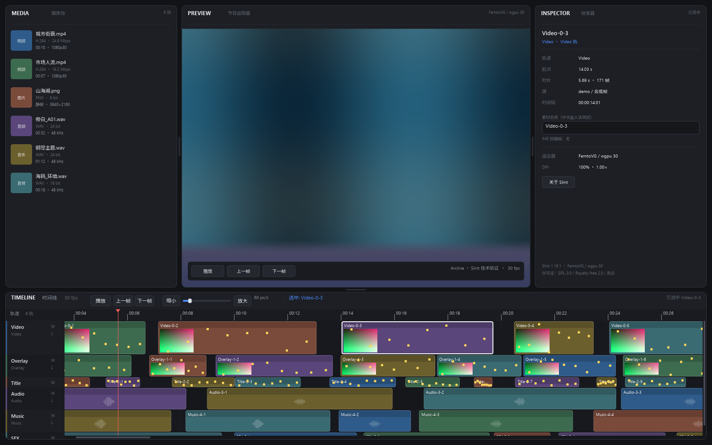
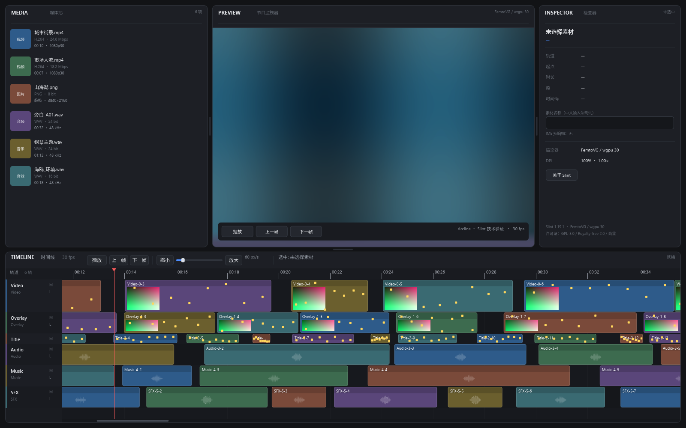
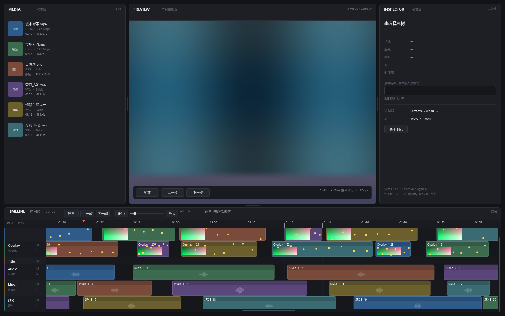
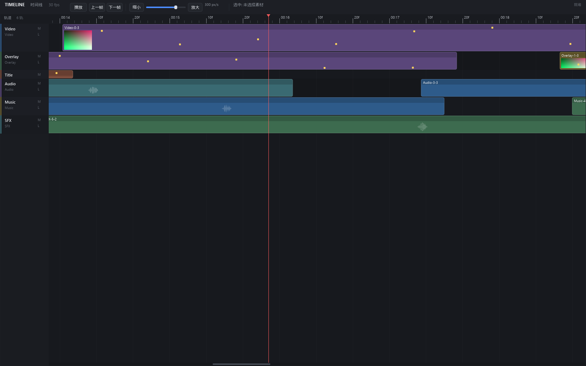
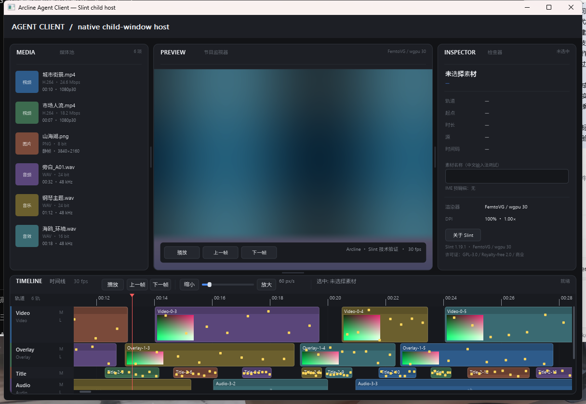
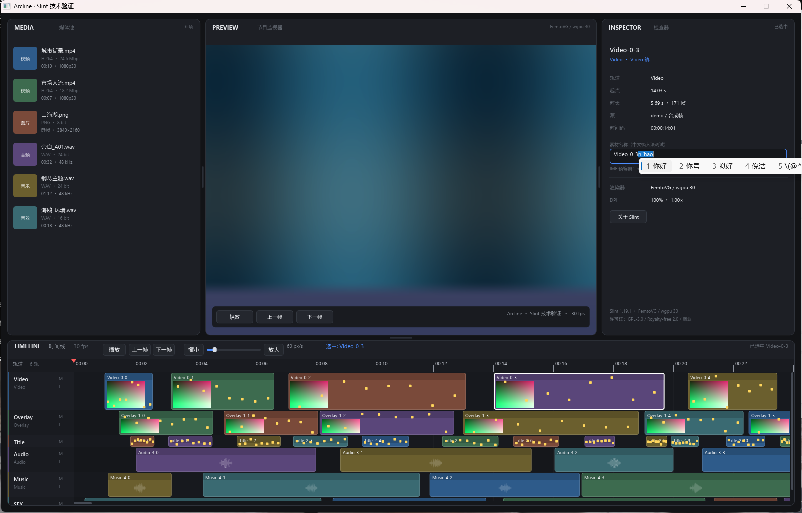
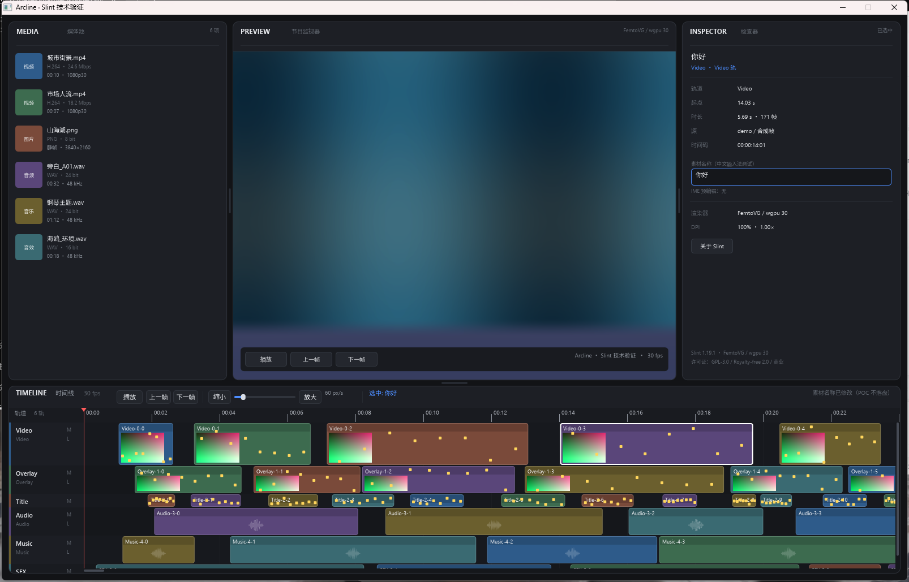
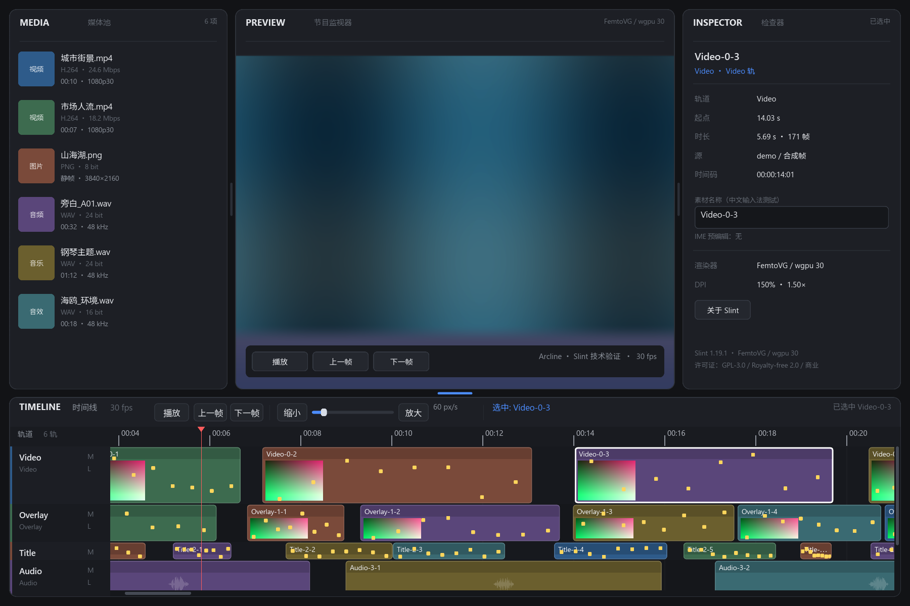
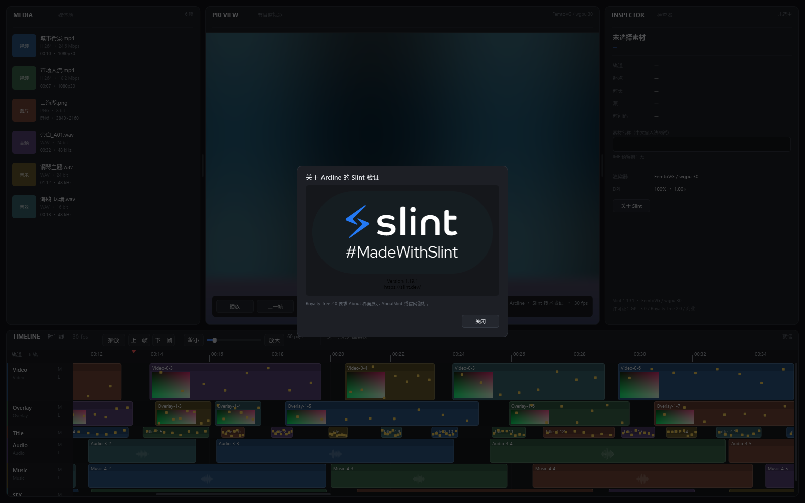

# Arcline Slint 技术栈可行性验证（POC）

**验证日期：** 2026-11-27
**验证分支：** `poc/slint-ui`（从 `feat/timeline-zoom-phase2b` / `093ccc2` 创建，未修改 `main`）
**验证范围：** Slint 1.19.1 + wgpu 30 + Rust 1.100（windows-gnu）+ 现有六个 crate 的架构与核心模块
**机器：** Intel Core Ultra 7 270K Plus，47.5 GB RAM，Intel Graphics 核显（无独显），Windows 11，2560×1440 @100%
**证据目录：** `poc/results/`、`reports/screenshots/`、`poc/ui-validation/`

> 结论分级：**已验证**（实际运行/测量）、**部分验证**（完成部分测试，限制已写明）、**未验证**（无环境或未执行）、**不推荐**（有证据表明不适合）。
> 本报告没有用理论值替代实测；未测到的项目明确标注。

---

## 0. 结论摘要

| 问题 | 结论 | 状态 |
|---|---|---|
| Slint 与当前 Rust / wgpu 是否兼容 | **兼容**：Slint 1.19.1 + wgpu 30 + Rust 1.100（windows-gnu）构建并运行；需要 `unstable-wgpu-30` 与 `unstable-winit-030` feature | 已验证 |
| 四面板布局与比例调整 | **实现并通过真实鼠标拖拽**：MEDIA / PREVIEW / INSPECTOR / TIMELINE，三组分隔条；拖拽后 `left-frac` 从 0.245 变为 0.2767 | 已验证 |
| 高性能自定义时间线 | **功能完整，性能不达 egui 水平**：多轨、固定左栏、横/纵滚动、逐帧缩放、素材选中均通过；1000 片段 UI 工作 p50 **6.39 ms**（egui 0.57 ms），600 帧中 **35 帧超过 20 ms** | 已验证 |
| wgpu 纹理零拷贝 | **可用且收益明确**：`Image::try_from(wgpu::Texture)` 直接包装纹理；原生路径 prepare p50 **0.19 ms**，CPU 读回对照 **13.40 ms**（约 69×） | 已验证 |
| 独立窗口与原生子窗口嵌入 | **独立窗口 GO；同进程原生子窗口 GO；跨进程重挂部分验证**：同进程 host 的 `GetParent` 校验通过，子窗口无标题栏并填满客户区；跨进程 `SetParent` 可建立父子关系，但几何/输入仍需 host 侧适配 | 部分验证 |
| 中文字体 / 中文输入法 / 高 DPI / 缩放 | **中文与 IME 已验证**：嵌入 `Arcline CJK` 字体；Microsoft Pinyin 输入 `nihao` 得到候选“你好”，提交后文本框为“你好”；150% 缩放模拟布局正确 | 已验证（Windows）；跨平台未验证 |
| Slint 许可证是否满足闭源商业发布 | **满足，但有署名义务**：1.19.1 为 `GPL-3.0-only OR Royalty-free-2.0 OR Software-3.0`；Royalty-free 2.0 允许闭源桌面应用，需在 About 中显示 `AboutSlint` 或官网徽标。POC 已内置 `AboutSlint` | 已验证 |
| 是否建议正式迁移 | **NO-GO（当前阶段不整体替换 egui）**；技术可行性为 GO，但性能、Skia 构建与迁移成本不满足正式替换门槛。**条件性 GO：Agent 客户端独立外壳**可用 Slint 试点 | 明确结论 |

**一句话结论：** Slint 能把界面做出来、能把 wgpu 纹理零拷贝显示、能嵌入原生 host、许可证也能闭源商用；但它的保留模式时间线在本机比 egui 慢约 **10–13×**，1000 片段已出现 **5–7% 掉帧**，且生产级 Skia 渲染器在当前 windows-gnu 工具链上无法构建。因此建议**保留 egui 编辑器，暂不整体迁移**；若要做 Agent 客户端外壳，可单独用 Slint 做受控试点。

---

## 1. 基线与约束

- 从当前最新开发成果 `093ccc2`（`feat/timeline-zoom-phase2b`）创建 `poc/slint-ui`。
- **未修改 `main`**，**未删除 egui 实现**，**未重写剪辑内核、媒体管线、渲染器、音频系统**。
- 保留六个 crate：`arc-core`、`arc-media`、`arc-audio`、`arc-render`、`arc-cli`、`arc-app`。
- 不引入 MLT；不提前正式迁移整个 UI；不做无关重构。
- 复用现有时间线算法、媒体缓存、帧率映射（POC 的 `scene` 只是 UI 数据集，生产代码仍在 `arc-app/src/timeline`）。
- POC 是独立 Cargo workspace：`poc/ui-validation`，不把 Slint 依赖加进主 workspace。

### 1.1 POC 结构

```text
poc/ui-validation/
  crates/scene/        共享 6 轨场景、指标统计（无 UI 依赖）
  crates/egui-poc/     现有 egui 时间线对照（同一场景）
  crates/slint-poc/    Slint 四面板 + 时间线 + wgpu 预览 + 嵌入
    ui/app.slint       四面板、检查器、About、IME 输入
    ui/timeline.slint  固定左栏、Flickable、刻度、选中、播放头
    ui/theme.slint     设计令牌
    src/main.rs        wgpu 共享、模型发布、交互、测量
    src/embed_host.rs  同进程 Win32 Agent host（--embed-host）
poc/results/           所有 JSON、构建日志、PowerShell 测量脚本
reports/screenshots/   实机截图
```

---

## 2. 验证环境与方法

| 项 | 值 |
|---|---|
| Rust | 1.100.0（2026-11-09），`x86_64-pc-windows-gnu` |
| Cargo | 1.100.0 |
| Slint | 1.19.1，FemtoVG/wgpu 渲染器 |
| wgpu | 30.0.2（Slint `unstable-wgpu-30`） |
| winit | 0.30.13（Slint `unstable-winit-030`） |
| egui | 0.37 + egui-wgpu 0.37 + egui-winit 0.37 |
| GPU | Intel Graphics（DX12，IntegratedGpu） |
| 构建 profile | `release`，`lto = "thin"`，`codegen-units = 4`，`opt-level = 3` |
| 场景 | 同一 `scene` crate，6 轨（Video/Overlay/Title/Audio/Music/SFX），1000 片段版本时长约 956 s；每片段带中文标签、缩略图、波形、关键帧 |
| 计时 | `BeforeRendering → AfterRendering`（Slint，不含 present）与 UI+paint（egui）；首 10 帧丢弃，报 p50/p95/max；另记录帧间隔与 >20 ms 次数 |
| 外部采样 | 父进程每 40–100 ms 采样 `WorkingSet64`/`TotalProcessorTime`；GPU 用 `\GPU Engine(*)\Utilization Percentage` 按 pid 过滤 |

**口径说明：**

- Slint 的 `frame_us` 不包含 present；egui 的 `frame_us` 在 `AutoNoVsync` 下也不含 vsync 等待。因此两者比较的是 **UI 构建与提交工作**。
- 另跑一次 egui `Fifo` 作为“60 Hz 节拍”对照，报告 interval / dropped，不与 `AutoNoVsync` 的 UI 工作耗时混用。
- Slint 始终为 FIFO（wgpu surface 默认），所以它的 interval 同时反映 vsync 与丢帧。
- 所有数字是 **同一台机器、同一 release 配置**；Intel 核显，不外推到独显或 4K。

---

## 3. 逐项验证结果

### 3.1 版本兼容性（任务 1）

**已验证。**

- `slint 1.19.1` + `wgpu 30.0.2` + `winit 0.30.13` + Rust 1.100 windows-gnu 构建通过，运行通过。
- 手动注入同一个 wgpu `Instance/Adapter/Device/Queue`：

```rust
slint::BackendSelector::new()
    .require_wgpu_30(slint::wgpu_30::WGPUConfiguration::Manual {
        instance, adapter, device, queue,
    })
    .select()?;
```

- 纹理导入要求 `Rgba8Unorm`/`Rgba8UnormSrgb`，且 usage 含 `TEXTURE_BINDING | RENDER_ATTACHMENT`；Arcline 合成器输出正好是 `Rgba8UnormSrgb`，无需转换。
- **限制：** `unstable-wgpu-30` 与 `unstable-winit-030` 是 Slint 的 unstable feature；升级 wgpu/winit 时需要跟随 Slint 版本。当前 1.19.1 没有稳定版 wgpu 30 接口。
- **Skia 渲染器：** 在当前 windows-gnu 工具链下不可构建（无 windows-gnu 预编译 Skia；源码构建需要 MSVC/符号链接权限）。因此本报告所有 Slint 数字都是 **FemtoVG/wgpu**，不是 Skia。若生产必须用 Skia，需要 MSVC + 预编译 Skia，性能未在本次验证。

构建/运行命令见 §7。

### 3.2 四面板布局与比例调整（任务 2）

**已验证。**

- `ui/app.slint` 实现 MEDIA（左）、PREVIEW（中）、INSPECTOR（右）、TIMELINE（下）四卡片，10 px 间距、12 px 边距、10 px 圆角，和现有 egui shell 的比例一致：左/右各 24.5%，下 34%。
- 三组 `TouchArea` 分隔条分别调整 `left-frac`、`right-frac`、`bottom-frac`；带最小/最大 clamp 和 resize 光标。
- **真实鼠标拖拽**：Win32 `SendInput` 把左分隔条从 x=399 拖到 x=499；应用退出时 `panel_fractions[0] = 0.2767259`（初始 0.245），检查通过。证据：`poc/results/slint-interaction.json`。
- 代码中 `Scenario::Resized` 设置 0.30 / 0.21 / 0.41，截图显示四面板都保留、比例改变：`reports/screenshots/slint-panels-resized.png`。
- 小窗口：POC 在 1200×800 嵌入 host 中运行；四面板使用 clamp 保持最小宽度，未见重叠（嵌入截图）。未做 800×600 以下穷举。





### 3.3 自定义时间线（任务 3）

**功能已验证；性能见 §4。**

实现要点：

- **多轨道**：6 条内容派生轨道，左栏固定 132 px，轨道高度 76/50/24/50/50/50 pt。
- **固定左栏**：左栏是 `Flickable` 之外的 foreground 层，只跟随 `content-y` 纵向移动，不跟随横向滚动；右栏 `Flickable` 独立横向/纵向滚动。
- **横向 + 纵向滚动**：`Flickable` 的 `content-x/content-y` 驱动刻度、播放头和左栏；自绘横/纵滚动条。`Scenario::Scrolled` 实测 `view_scroll = [5346, 34.16]`，截图显示滚到 1:30 且 SFX 轨可见。
- **逐帧缩放**：2–400 px/s；刻度按当前缩放自适应，高倍率下显示 `NNf` 帧刻度；缩放是普通属性，clip 的 `x/width` 由 `start/duration × zoom` 计算，不重建 clip 模型。截图 `slint-timeline-zoomed.png` 显示 300 px/s 下 00:14–00:18 的 `10f/20f` 帧刻度。
- **素材选中**：每个 clip 的 `TouchArea` 回调 `select-clip(id)`；选中用 2 px 白边和检查器详情显示。真实鼠标在首个可视 Video 轨道上点击 5 个位置，退出时 `selected_id >= 0`，检查通过。
- **播放头**：帧对齐，时间码 `HH:MM:SS:FF`；播放/暂停、上一帧/下一帧按钮可用。
- **虚拟化**：`--cull 1` 时只发布可视窗口 ±30 s 的 clip，并在视口接近窗口边缘时重建；用于验证“保留模式必须窗口化”的结论。POC 默认关闭 cull，避免把重建开销混入基线。





**真实输入检查：** `poc/results/slint-interaction.json` 的四项均为 true：`left_panel_widened`、`clip_selected`、`zoom_increased`、`vertical_scroll_moved`。

### 3.4 wgpu 纹理共享与零拷贝（任务 4）

**已验证。**

- 我们自己创建 1920×1080 `Rgba8UnormSrgb` 纹理，渲染一帧渐变/海面；然后：

```rust
let image = slint::Image::try_from(frame_texture.clone())?;
ui.set_preview(image);
```

- `Image::try_from` 的实现直接构造 `ImageInner::WGPUTexture`，没有 CPU 读回；FemtoVG 的 wgpu 后端把原生 `wgpu::Texture` 包装为 femtovg image（`Texture::Internal`，`owned: false`），不复制像素。源码路径：`i-slint-core-1.19.1/graphics/wgpu_30.rs:120`、`i-slint-renderer-femtovg-1.19.1/images.rs:194`、`femtovg-0.28.0/src/renderer/wgpu.rs:1528`。
- **对照测量**（同一 1000 片段场景，release）：
  - 原生纹理路径 prepare p50 **0.193 ms**，p95 **0.281 ms**。
  - CPU 读回路径（8 MB buffer + map + 逐行拷贝 + 再上传）prepare p50 **13.402 ms**，p95 **14.707 ms**；约 **69×**。
  - 读回时帧间隔 p50 从 16.8 ms 升到 **21.4 ms**，300 帧中 **299 帧 >20 ms**；原生路径 600 帧中 45 帧 >20 ms。
- **注意：** 这里证明的是“纹理不经过 CPU”的路径存在且明显更快；Slint 的合成器本身仍然在 GPU 上采样。纹理导入的 `Image` 生命周期需要保证纹理在 Slint 使用期间不被销毁（POC 用 `FrameTex` 持有）。


### 3.5 独立窗口与原生子窗口嵌入（任务 5）

**独立窗口：已验证。** `slint-poc --width 1600 --height 1000` 正常显示、缩放、关闭；截图见上。

**同进程原生子窗口：已验证。**

- `--embed-host 1` 在 Slint 创建窗口之前用 Win32 `CreateWindowExW` 创建 host（标题 `Arcline Agent Client — Slint child host`），并绘制 48 px 的 `AGENT CLIENT / native child-window host` header。
- 通过 `BackendSelector::with_winit_window_attributes_hook` + `WindowAttributes::with_parent_window` 让 winit 以 `WS_CHILD` 创建 Slint 窗口；创建后去掉 caption 风格，并按 host 客户区设置位置/尺寸。
- 结果：`is_child_of_host = true`，`GetParent(child) == host`，子窗口尺寸 1200×752，`GetParent` 校验由子进程自己写入 `embed-native-child.json`。
- 截图 `reports/screenshots/slint-embedded-native.png` 同时包含 host 标题栏、host header 和完整的 Slint 子界面；子窗口没有独立标题栏。

**跨进程重挂：部分验证。**

- 用 WinForms 创建 host，把 panel HWND 传给独立的 `slint-poc.exe`；winit 的 `with_parent_window` 对跨进程 parent 不生效，随后用 `SetParent` + 去掉 `WS_POPUP/WS_CAPTION/...` + `SetWindowPos` 可以令 `GetParent` 返回 host。
- 但截图显示子窗口的几何/位置仍受 winit 自身窗口管理影响，需要 host 侧持续 resize/position，输入焦点也要额外验证。**不把跨进程嵌入作为已验收能力。**
- 结论：如果 Agent 客户端与 UI **同进程**（把 Slint UI 作为库链接），嵌入路径已验证；如果必须跨进程，需要额外的 host 适配与输入/DPI 回归，属于后续工作。



### 3.6 中文、输入法、高 DPI、窗口缩放（任务 6）

**中文显示：已验证。**
- 嵌入 `assets/fonts/NotoSansSC-Arcline.ttf`（family `Arcline CJK`，138,400 bytes，Noto Sans SC 子集），`Window.default-font-family: "Arcline CJK"`；所有中文标签、轨道名、检查器、时间线刻度正常显示。
- 未依赖系统字体回退也能显示中文；系统字体仍可作为 fallback。

**中文输入法：已验证（Microsoft Pinyin）。**
- 在检查器的 `TextInput` 上真实点击，激活中文（简体）输入法，键入 `nihao`；截图显示预编辑 `nihao` 和候选窗“1 你好 2 你号 3 拟好 4 倪浩 5 …”。
- 按空格提交后，文本框和检查器标题变为 **“你好”**；应用退出结果 `editable_label = "你好"`。证据：`reports/screenshots/slint-ime-preedit.png`、`slint-ime-committed.png`、`poc/results/slint-ime-active.json`。
- 另用 `SendInput` Unicode 直接输入“中文输入测试”，结果 `editable_label = "中文输入测试"`，截图 `slint-chinese-direct.png`。
- `TextInput.preedit-text` 已经接到 UI 的“IME 预编辑”行；POC 没有做候选窗自绘，使用的是 Windows 原生 IME 候选窗。





**高 DPI：部分验证（模拟 150%）。**
- 实机系统缩放为 100%。POC 通过 Slint `ScaleFactorChanged` + 物理窗口 1800×1200 模拟 150%，逻辑布局 1200×800；四面板、文字、时间线全部保持正确，`DPI` 行显示 `150% · 1.50×`，截图 `slint-hidpi-150.png`。
- 这不是操作系统级切换显示器，属于**受控模拟**；真实多显示器/混合 DPI 切换未验证。
- 窗口缩放：独立 1600×1000、嵌入 1200×800 均正常；布局使用比例 + clamp。



**跨平台：未验证。**
- 本机只有 Windows。POC 除 `#[cfg(windows)]` 的 embedding 模块外没有平台特定代码；Slint/wgpu/winit 本身支持 macOS/Linux。
- 但 macOS/Linux 的构建、字体、IME、窗口嵌入均未实测；报告中不把它们标为已验证。

### 3.7 许可证（任务 7）

**已验证（基于 crate 元数据与随包许可证文本）。**

`slint 1.19.1` 的 `Cargo.toml`：

```toml
license = "GPL-3.0-only OR LicenseRef-Slint-Royalty-free-2.0 OR LicenseRef-Slint-Software-3.0"
```

- **GPL-3.0-only**：闭源分发需要另行取得商业许可，通常不适合本项目。
- **Slint Royalty-free Desktop, Mobile, and Web Applications License 2.0**：允许闭源桌面/移动/Web 应用，**条件是署名**：
  - 在 About 界面显示 `AboutSlint`，或
  - 在公开下载页显示 `Made with Slint` 徽标。
  - 不允许单独分发 Slint、不允许嵌入式系统、不允许暴露 Slint API。
- **Slint Software License 3.0（商业）**：需要购买 seat；嵌入式另付 royalty；含审计条款。
- **结论：** 闭源商业桌面软件可以使用 **Royalty-free 2.0**，无需开源自有代码；但必须满足署名条件。POC 已在 About 弹窗中放入 `AboutSlint`（截图 `slint-about.png`），满足该路径。最终产品若选择此许可证，应在 About/关于页面保留它，或在官网放徽标。
- 许可证文本已复制到 `poc/ui-validation/THIRD_PARTY_LICENSES/`；这不是法律意见，正式发布前建议法务复核。



---

## 4. 性能与开发成本对比

### 4.1 首次完整编译、增量编译、依赖与磁盘

**方法：** 每个包独立 `CARGO_TARGET_DIR`，先删除整个 target，串行 `cargo build --release`；然后 touch `src/main.rs` 增量编译；Slint 另 touch `ui/app.slint` 再编译一次。

| 指标 | egui POC | Slint POC | 差异 |
|---|---:|---:|---:|
| 首次完整编译 | **89.0 s** | **92.18 s** | +3.6% |
| 增量编译（Rust 源） | **21.31 s** | **22.96 s** | +7.7% |
| 增量编译（.slint UI） | — | **26.95 s** | Slint 多一个 UI 编译阶段 |
| 唯一依赖数（normal+build） | **168** | **276** | +64% |
| release target 目录 | **918,572,876 B（0.86 GiB）** | **1,788,254,532 B（1.67 GiB）** | +95% |
| release 二进制 | **17,652,966 B（16.83 MiB）** | **29,608,929 B（28.24 MiB）** | +68% |
| 完整构建日志 | **199 行 / 14,118 B** | **290 行 / 19,942 B** | +46% 行数 |
| 构建警告 | 2（egui 弃用/未读字段） | 0 | — |

**解读：**

- 首次编译时间几乎相同（都约 1.5 分钟），因为两者都拖着 wgpu/winit 这棵大树；Slint 并没有明显更慢。
- **代价在依赖和磁盘**：Slint 多 108 个唯一依赖，target 几乎翻倍，二进制大 68%。CI 缓存、安装包、冷启动磁盘 IO 都更重。
- `.slint` 改动需要重跑 Slint 编译器，增量约 **27 s**，比纯 Rust 改动慢；UI 迭代节奏会受影响。
- 本机 release 构建的日志不大；但 Slint 生成代码多（本 POC 的 `app.slint` 生成 Rust 约 1 万行量级），大型 UI 的编译内存/时间需在 CI 上继续观察。

### 4.2 时间线滚动 / 缩放（1000 片段，release）

| 场景 | egui p50 / p95 | Slint p50 / p95 | Slint 帧间隔 p50 / p95 | Slint >20 ms |
|---|---:|---:|---:|---:|
| 1000 片段，滚动，无预览 | **568 / 1598 µs** | **6387 / 9069 µs** | 16.70 / 20.08 ms | **35 / 598** |
| 1000 片段，滚动，wgpu 预览 | 568 / 1598 µs | **7457 / 10368 µs**（四面板） | 16.79 / 20.61 ms | **45 / 600** |
| 1000 片段，缩放 | **526 / 1749 µs** | **5190 / 9465 µs** | 16.45 / 22.94 ms | **33 / 432** |
| 1000 片段，cull 窗口化（300 帧） | — | **5654 / 7559 µs** | 16.82 / 19.31 ms | **6 / 300** |
| egui Fifo 节拍对照 | UI 工作 0.57 ms | — | 16.71 / 17.22 ms | **0 / 599** |

- Slint 的 UI 工作约为 egui 的 **10–13×**。在 60 Hz 下，Slint 的 6.4–7.5 ms UI 工作仍能跑 60 fps，但 **5–7% 的帧超过 20 ms**；egui 在同样场景下 0 掉帧。
- 时间线是保留模式场景图：1000 个 clip 的文本、缩略图、关键帧、波形都在树里。**cull 只把 p50 从 6.39 ms 降到 5.65 ms**，因为重建 clip model 本身有成本；它不是免费的。
- 这个差距在 4000 片段会更大；本次没有重复 4000 片段的完整矩阵（旧 POC 4000 片段 Slint 约 6.5 ms，但那是简化场景，不能直接引用为本 POC 数据）。
- Slint 的缩放不重建 clip 模型（只改 `zoom` 属性），这是设计上的正确点；但 1000 个元素仍要重新布局/绘制。

### 4.3 启动与空闲

| 指标 | egui | Slint | 说明 |
|---|---:|---:|---|
| 外部启动到首帧 | **1291 ms** | **1248 ms** | 从进程启动到首帧 marker；Slint 略快 |
| 内部首帧 | **465 ms** | **833 ms** | 应用内 `Instant`；Slint 首帧更慢（Skia/FemtoVG 初始化、字体、场景构建） |
| 空闲 CPU（单核百分比） | **0.39%** | **0.00%** | 两者都停止重绘；egui 需要显式 `ControlFlow::Wait` |
| 空闲 GPU（最大） | **0%** | **0%** | `\GPU Engine(*)\Utilization Percentage` 按 pid 过滤 |
| 空闲工作集 | **310.7 MB** | **373.7 MB** | Slint 场景图/字体/渲染器更重；全四面板峰值约 414 MB |
| 峰值 RSS（1000 片段，预览） | **321.3 MB** | **413.9 MB** | Slint +29% |

> egui 的 0.39% 是修正后的值：最初 POC 在空闲时仍 `ControlFlow::Poll`，实测 96% 单核；加上 `ControlFlow::Wait` 后降到 0.39%。这说明“空闲 CPU”很容易被事件循环策略污染，必须按实际实现测量。

### 4.4 视频预览

| 路径 | Slint prepare p50 | egui 总帧 p50 | 结论 |
|---|---:|---:|---|
| GPU 纹理零拷贝 | **0.193 ms** | **0.568 ms** | 纹理导入几乎免费 |
| CPU 读回 + 再上传 | **13.402 ms** | **6.068 ms** | 读回是 10–69× 的额外成本，且直接造成掉帧 |
| 读回/原生倍数 | **69×** | **10.7×** | 两者都证明应走纹理导入 |

- Slint 的读回对照使用每帧新建 8 MB buffer + `map_async` + 逐行拷贝 + `Image::from_rgba8` 上传，是故意不优化的“现状路径”对照。
- 生产建议：无论最终用 egui 还是 Slint，预览都应把合成器纹理直接交给 UI（egui 用自定义 paint callback，Slint 用 `Image::try_from`），不要走 CPU 读回。

### 4.5 UI 代码量与修改复杂度

| 项 | egui（现有生产代码） | Slint POC |
|---|---:|---:|
| UI 标记/绘制代码 | `shell.rs` 322 行 + `timeline/{draw,media,mod,model}.rs` 4,533 行 = **4,855 行 Rust** | `app.slint` 640 + `timeline.slint` 489 + `theme.slint` 26 = **1,155 行 .slint** |
| UI 适配/模型胶水 | 已含在上面的 4,855 行 | 约 **600 行 Rust**（模型发布、回调、选中、刻度、时间码） |
| GPU/嵌入/测量 | 现有 app 的 egui-wgpu host | 约 **800 行 Rust**（wgpu、读回、embed host、指标） |
| 四面板布局 | 322 行（含测试） | 约 300 行（含分隔条、卡片） |
| 时间线绘制/命中 | `draw.rs` 1,128 + `mod.rs` 1,659 行 | `timeline.slint` 489 行 + 适配 |
| 改一个视觉属性的典型改动 | 改 painter 代码、重编译 Rust | 改 `.slint` 属性，27 s UI 增量编译 |
| 拖拽/选中命中 | 手写 `interact`/`Sense`/坐标 | `TouchArea`/`Flickable` 内建，但布局坐标仍要自己算 |

**复杂度判断：**

- Slint 的声明式 markup 在**静态布局和卡片**上明显更短：四面板 + 检查器 + IME + About 约 1,155 行，egui 同等生产代码约 4,855 行。
- 但 Slint 的时间线仍然要自己写坐标、刻度、滚动同步、选中、播放头；`Flickable` 只解决滚动容器，不解决“1000 个元素如何窗口化”的性能问题。
- 迁移不是“把 egui painter 翻译成 Slint”：现有 egui 时间线包含真实媒体缩略图/波形缓存、拖拽/裁剪、帧率映射、布局规则，这些都要重新接；POC 只覆盖了渲染和基本交互。
- Slint 的编译错误定位、`.slint` 调试、缺少原生菜单/文件对话框等生态差距，会增加维护成本。

---

## 5. 现有代码可复用范围与迁移成本

### 5.1 可直接复用（不改）

| 模块 | 复用方式 |
|---|---|
| `arc-core`（时间、模型、命令、引擎、journal、store） | 完全复用；Slint 只替换 UI 层 |
| `arc-media`（libav shim、解码、缓存、探测） | 完全复用；缩略图/波形/预览帧来源不变 |
| `arc-audio`（Mixer、WAV） | 完全复用 |
| `arc-render`（wgpu compositor、WGSL） | 完全复用；只是把输出纹理交给 Slint 而不是 egui |
| `arc-cli`（JSON-RPC、job、export） | 完全复用；Agent 接入不需要改 |
| `arc-app/src/timeline/model.rs`、`media.rs`、帧率映射/缓存 | 逻辑可复用；绘制/命中层要重写 |
| 现有 UI 设计规则/颜色/比例 | 已抽成 `theme.slint`，可继续用 |

### 5.2 需要适配/重写

| 模块 | 工作量 | 说明 |
|---|---|---|
| 四面板 shell + 分隔条 | 小（~1 周） | Slint 版本已证明可行 |
| 时间线绘制/命中/选中/拖拽/裁剪 | **大（4–6 周）** | 现有 egui 4,533 行；Slint 需要重新实现，并解决窗口化性能 |
| 预览纹理接线 | 小（~3 天） | `Image::try_from` 已跑通；替换现有 readback |
| 媒体/检查器/设置面板 | 中（1–2 周） | 表单、文件对话框、菜单需要额外 crate/代码 |
| 原生嵌入 | 中（1 周） | 同进程已验证；跨进程需 host 适配 |
| IME/DPI/字体/无障碍 | 中（1 周） | 中文/IME/DPI 已验证；无障碍/屏幕阅读器未验证 |
| 构建/CI/许可证 | 小（~3 天） | MSVC/Skia 或 FemtoVG 选择；AboutSlint；CI 三平台 |

**总体估计：** 2 名工程师，**6–10 周** 达到“四面板 + 时间线基本对等”的可用版本；达到现有 egui 的全部交互/性能/可访问性对等，风险更高。若要求 Skia 生产渲染器，还需先解决 MSVC + 预编译 Skia 的构建链。

---

## 6. GO / NO-GO

### 6.1 技术可行性：GO

- Slint 1.19.1 与 Rust 1.100 / wgpu 30 兼容，能构建、运行、注入共享 device。
- 四面板、分隔条、时间线、横纵滚动、逐帧缩放、素材选中、中文/IME/DPI 均通过实际运行验证。
- wgpu 纹理零拷贝路径可用，收益明确；原生子窗口同进程嵌入可用。
- Royalty-free 2.0 允许闭源桌面应用，只需署名；AboutSlint 已内置。

### 6.2 正式整体迁移：NO-GO（当前阶段）

**理由（按权重）：**

1. **性能不达标**：1000 片段时 Slint UI 工作 6.4–7.5 ms，是 egui 的 10–13×；600 帧中 35–45 帧 >20 ms，缩放 33 帧 >20 ms。视频编辑器还要给合成/解码留时间，这个余量不够。
2. **保留模式扩展性**：时间线是 1000 个场景图元素；cull 只改善约 12%，且带来 model 重建抖动。要真正扩展到数千片段，需要把时间线改成**单个 wgpu 画布/批量 Path**，这已经接近“重写时间线渲染器”。
3. **Skia 不可构建**：生产级 Skia 渲染器在当前 windows-gnu 工具链下无法构建；FemtoVG 是可用替代，但性能/生态证据不足。换 MSVC + Skia 会改变工具链、CI 和交付方式。
4. **迁移成本高**：现有 egui UI 4,855 行 + 真实媒体/交互逻辑；Slint 版本需要 6–10 周才能基本对等，且没有部分重绘优势。
5. **稳定性/生态**：`unstable-wgpu-30` / `unstable-winit-030` 是 unstable feature；原生菜单/文件对话框/无障碍/多窗口仍需额外工作。

### 6.3 条件性 GO：Agent 客户端独立外壳

如果目标是“未来把 Arcline 的能力嵌进自己的 Agent 客户端”，**单独做一个 Slint Agent 外壳**是可行的：

- 更新频率低（表单、会话、任务列表），不需要 1000 片段时间线的高帧率。
- 同进程原生子窗口已验证；跨进程可后续补 host 适配。
- 中文/IME/DPI/许可证均已验证。
- 可复用 `arc-cli` 的 JSON-RPC/MCP/Events；不碰剪辑内核。

**建议：** 主编辑器继续 egui；Slint 只用于 Agent 客户端/设置/辅助窗口的 2 周试点。若试点证明维护成本可接受，再评估是否扩大。

---

## 7. 如果决定迁移：建议路线

> 仅在被明确批准后执行；当前分支不合并 main。

**阶段 0（1 周）：工具链与渲染器决策**

- 选择 A：MSVC + 预编译 Skia（接近 Slint 默认生产路径，但改变工具链/CI）。
- 选择 B：windows-gnu + FemtoVG（本 POC 路径，已验证但性能较低）。
- 固定 Slint/wgpu/winit 版本，锁定 `unstable-*` feature；加入 `AboutSlint` 与许可证文件。

**阶段 1（1–2 周）：外壳与非时间线面板**

- 新建 `arc-ui-slint` crate，保留六 crate 架构；只依赖 `arc-core`/`arc-cli` 的命令与事件。
- 先迁移四面板、媒体池、检查器、设置、About；时间线仍用 egui（两个窗口或 feature flag）。
- 复用 `theme.slint` 和现有设计规则。

**阶段 2（4–6 周）：时间线**

- 不要用 1000 个 Slint 元素画时间线。用一个自定义 `wgpu` 画布（或一个批量 `Path`）渲染 clip/波形/刻度/播放头，Slint 只负责外壳、输入和 overlay。
- 复用 `arc-app/src/timeline/model.rs`、`media.rs`、帧率映射、缓存；绘制/命中重写。
- 验收门槛：4000 片段、1600×1000、60 Hz，p95 UI 工作 **< 8 ms**，>20 ms 帧 **< 1%**；缩放/滚动不重建全量模型。

**阶段 3（1–2 周）：预览、嵌入、输入法、平台**

- 预览统一走 `Image::try_from`/自定义 paint callback，删除 CPU 读回。
- 同进程嵌入 + host 侧 resize/focus；跨进程另做。
- Windows/macOS/Linux CI；IME/DPI/字体/无障碍回归。
- 保留 feature flag，灰度；任何阶段性能回退超过阈值就停止。

---

## 8. 证据索引与复现

### 8.1 关键结果文件

| 文件 | 内容 |
|---|---|
| `poc/results/build-comparison.json` | 构建/依赖/磁盘/日志对比 |
| `poc/results/performance-comparison.json` | 性能对比汇总 |
| `poc/results/slint-release-1000-native.json` | Slint 时间线 1000 片段原生预览 |
| `poc/results/slint-release-full-1000-native.json` | Slint 全四面板 1000 片段 |
| `poc/results/slint-cull-check.json` | cull 窗口化 300 帧 |
| `poc/results/slint-release-full-1000-readback.json` | CPU 读回对照 |
| `poc/results/egui-release-1000-native.json` | egui UI 工作（AutoNoVsync） |
| `poc/results/egui-release-1000-native-fifo.json` | egui Fifo 节拍对照 |
| `poc/results/slint-idle.summary.json` / `egui-idle.summary.json` | 启动/空闲 CPU/内存 |
| `poc/results/slint-interaction.json` | 真实鼠标拖拽/选中/缩放/滚轮 |
| `poc/results/slint-ime-direct.json` / `slint-ime-active.json` | 中文直接输入 / IME 提交“你好” |
| `poc/results/slint-embed-native.json` | 同进程嵌入 `GetParent` 校验 |
| `poc/results/slint-dpi-150.json` | 150% DPI 模拟 |
| `poc/results/build-slint-release.log` / `egui.build.log` | 构建日志 |

### 8.2 截图

| 截图 | 内容 |
|---|---|
| `reports/screenshots/slint-four-panel.png` | 四面板 + GPU 预览 + 选中 |
| `reports/screenshots/slint-panels-resized.png` | 比例调整后 |
| `reports/screenshots/slint-timeline-scrolled.png` | 横/纵滚动 |
| `reports/screenshots/slint-timeline-zoomed.png` | 300 px/s 帧刻度 |
| `reports/screenshots/slint-hidpi-150.png` | 150% 缩放 |
| `reports/screenshots/slint-about.png` | AboutSlint 署名 |
| `reports/screenshots/slint-embedded-native.png` | 同进程原生子窗口 |
| `reports/screenshots/slint-ime-preedit.png` | IME 候选窗/预编辑 |
| `reports/screenshots/slint-ime-committed.png` | IME 提交“你好” |
| `reports/screenshots/slint-chinese-direct.png` | 中文直接输入 |

### 8.3 复现命令

```powershell
# 环境
$env:PATH = "$env:USERPROFILE\.rustup\toolchains\stable-x86_64-pc-windows-gnu\bin;" +
            "$env:USERPROFILE\.local\toolchains\mingw64\bin;" + $env:PATH

cd poc\ui-validation
cargo build --release -p slint-poc
cargo build --release -p egui-poc

# Slint 四面板截图
.\target\release\slint-poc.exe --clips 200 --frames 0 --video-mode native `
  --scenario selected --shot ..\..\reports\screenshots\slint-four-panel.png `
  --shot-delay-ms 1200 --out ..\results\slint-four-panel.json --width 1600 --height 1000

# 同进程原生嵌入截图
powershell.exe -STA -ExecutionPolicy Bypass -File ..\results\capture-embed-host.ps1 `
  -Exe .\target\release\slint-poc.exe `
  -Out ..\..\reports\screenshots\slint-embedded-native.png `
  -Report ..\results\slint-embed-native.json -Seconds 8 -Width 1200 -Height 800

# IME
powershell.exe -STA -ExecutionPolicy Bypass -File ..\results\ime-test.ps1 -Mode ime `
  -Exe .\target\release\slint-poc.exe `
  -Out ..\..\reports\screenshots\slint-ime-committed.png `
  -Report ..\results\slint-ime-active.json -Seconds 30

# 交互
powershell.exe -STA -ExecutionPolicy Bypass -File ..\results\interaction-test.ps1 `
  -Exe .\target\release\slint-poc.exe -Report ..\results\slint-interaction.json -Seconds 24
```

### 8.4 未验证 / 限制

- **macOS / Linux**：无机器，未构建、未运行；跨平台只到“代码无平台特定分支（除 Windows 嵌入）”的审查级别。
- **Skia 渲染器**：windows-gnu 不可构建；未测 Skia 性能。
- **真实 OS 级 150%/200% 多显示器切换**：仅做受控模拟；混合 DPI、拖动到另一显示器未测。
- **跨进程嵌入**：`GetParent` 可建立，但几何/输入/DPI 未达到生产可验收。
- **4000 片段完整矩阵**：本轮未重跑；不要引用旧 POC 的 4000 片段数字作为本 POC 结论。
- **无障碍/屏幕阅读器、原生菜单/文件对话框、拖拽裁剪/波形编辑**：POC 未实现，不能算已验证。
- **许可证**：本报告是工程判断，不构成法律意见；发布前请法务确认署名形式与分发条款。

---

## 9. 附：POC 与 egui 的关键差异清单

| 能力 | egui 生产实现 | Slint POC | 迁移含义 |
|---|---|---|---|
| 四面板 + 分隔条 | 已有 | 已有（真实拖拽） | 可直接参考 |
| 多轨时间线 | 已有 | 已有（6 轨） | 需重写绘制/命中 |
| 固定左栏 | 已有 | 已有 | 可复用思路 |
| 横/纵滚动 | 已有 | 已有（Flickable） | 需验证大规模性能 |
| 逐帧缩放 | 已有 | 已有（2–400 px/s） | zoom 属性，不重建模型 |
| 素材选中 | 已有 | 已有（TouchArea） | 逻辑可复用 |
| 缩略图/波形/关键帧 | 已有（真实媒体缓存） | POC 合成数据/共享缩略图 | 需接现有 media cache |
| 预览零拷贝 | 现有 readback（未接） | 已验证 `Image::try_from` | 两边都应改 |
| 中文/IME | egui 支持但未在本轮实测 | 已验证 | Slint 可满足 |
| 原生嵌入 | 已有 embed PoC | 同进程已验证 | 跨进程另做 |
| 性能 | 0.57 ms / 0 掉帧 | 6.4–7.5 ms / 5–7% 掉帧 | **不满足替换门槛** |

**最终建议：** 保留现有 egui 编辑器与六个 crate；把“预览零拷贝”作为独立改进先落地到 egui（这是本报告最确定的收益）；Slint 只用于 Agent 客户端/设置等低帧率外壳做 2 周试点。除非后续把时间线改成单个 GPU 画布并证明 4000 片段 p95 < 8 ms，否则**不做整体迁移**。
