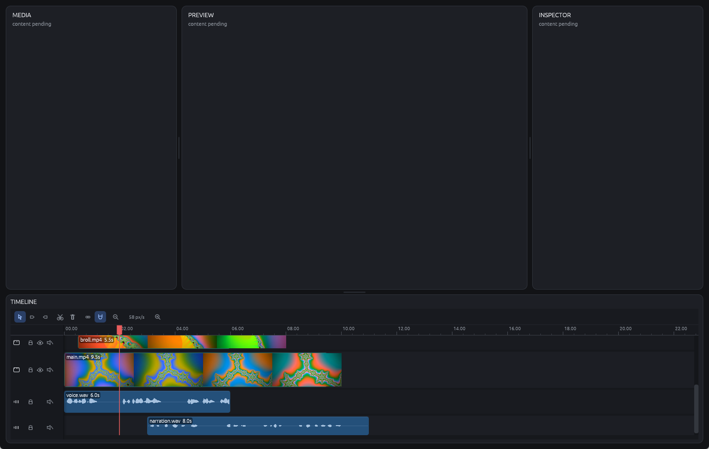
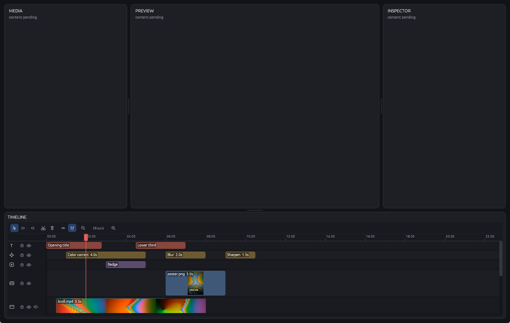

# Timeline Phase 1 — real media clip visualisation (2026-11-26)

Phase 1 only: the mock timeline's clips now show **real decoded media** — video frames, still images
and audio waveforms — with real text/effect/sticker names. No editing commands, engine or document
changes were made, and the approved timeline layout, track heights and the fixed left column are
unchanged. The work is based on the approved timeline implementation (`9a6ef98`, plus the playhead
synchronisation fix `853ed9d`); the media layer is additive.

## What was built

| Area | Implementation |
|---|---|
| Decode workers | `crates/arc-app/src/timeline/media.rs`: one picture worker (video frames + stills) and one audio worker, both off the UI thread; results are polled once per frame |
| Video thumbnails | Real frames from `arc_media::VideoDecoder::frame_at`, tiled across the clip at source timestamps from a zoom-dependent ladder; centre-cropped to the tile so nothing is distorted |
| Still images | Decoded once with the same libav decoder, aspect-fitted and centred in the clip |
| Audio waveforms | `AudioDecoder` decodes the file once into a 200 peaks/second min/max envelope; each painted column aggregates its own source-time range, so quiet and loud passages differ and density follows the zoom |
| Labels | Actual text ("Opening title", "Lower third"), effect names ("Color correct", "Blur", "Sharpen"), sticker names ("Badge"), and file name + duration for media clips; elided with `…` inside the clip |
| Missing media | Missing or undecodable sources draw a hatched "media unavailable" state instead of a fake thumbnail/waveform |
| Demo media | `assets/demo/` (generated, no third-party content) + `scripts/demo-media.ps1` and its `README.md` |

The mock project now points at real files: `main.mp4` (12 s Mandelbrot dive), `broll.mp4` (8 s
Mandelbrot zoom-out), `poster.png` (480×720 title card), `voice.wav` (Zira speech, 8.7 s) and
`narration.wav` (Huihui speech, 12.5 s).

## Thumbnail and waveform caching

- **Keys are content-addressed, not frame-addressed**: video thumbnails are keyed by
  `(path, source_millisecond)`, stills by `path`, waveforms by `path`. Scrolling and repainting hit
  the same keys, so cached textures are reused without decoding.
- **Timeline positions map to source times** by tiling: the tile step is the smallest value on a
  fixed ladder `{0.1, 0.125, …, 20} s` whose tile is at least one thumb wide at the current zoom.
  Each tile requests the frame at its midpoint (`tile·step + step/2`). Because the step only changes
  when the zoom crosses a ladder rung, normal zooming and scrolling reuse cached frames; the unit
  test `thumb_step_grows_as_the_timeline_zooms_out` pins the ladder and the tile-width bounds.
- **Bounded LRU caches** (`Lru` in `media.rs`): 128 video textures, 8 still images, 12 waveform
  envelopes, 3 open decoders. Textures are `egui::TextureHandle`s, so eviction frees GPU memory;
  decoders are evicted as LRU too.
- **Request budget**: at most 6 new decode requests per painted frame; while work is pending the hub
  schedules a repaint (`request_repaint_after(60 ms)`), so a zoom-out burst cannot flood the worker
  or the queue. Pending keys are de-duplicated (`pending_requests_are_deduplicated`).
- **Failures are terminal per path**: a missing file is reported once, cached, and never requested
  again on repaint (`missing_media_is_reported_once_and_never_crashes`).
- **No decode in the paint path**: painting only looks up caches and requests misses; decoding
  happens on the worker threads (2 threads total per timeline instance, started on the first
  painted frame and stopped when the timeline is dropped).

## Screenshots

Real video thumbnails, real image, real waveforms and the per-clip labels:

Text, effect and sticker clips with their real names, the image clip and the b-roll clip:

## Acceptance criteria

| # | Criterion | Evidence |
|---|---|---|
| 1 | Real video thumbnails | `main.mp4` and `broll.mp4` clips show distinct decoded frames; frames at different tiles are visibly different; `real_demo_media_decodes` decodes a frame from `main.mp4` |
| 2 | Real image thumbnails | `poster.png` decoded and displayed, aspect 2:3 preserved and centred |
| 3 | Real audio waveforms | `voice.wav` / `narration.wav` decoded to envelopes; the screenshots show speech bursts and pauses, not a repeated pattern |
| 4 | Text clips show actual text | "Opening title" / "Lower third" labels |
| 5 | Effect clips show actual names | "Color correct 4.0s", "Blur 2.0s", "Sharpen 1.5s" |
| 6 | Sticker clips show actual names | "Badge" |
| 7 | Labels never overflow | labels are drawn with `elide_text` to `clip width − 10 pt` and clipped to the clip rect (`elide_keeps_short_text_and_truncates_long_text`) |
| 8 | Scrolling renders correctly | thumbnails and waveforms are positioned from clip start + scroll; the fixed column layering from revision 3 is untouched |
| 9 | Zoom updates density | tile step ladder (thumbnails) and per-column aggregation (waveform); `thumb_step_grows_as_the_timeline_zooms_out` |
| 10 | Cached media reused | `cache_hits` counter; cache keys are independent of scroll position |
| 11 | No repeated full decoding | one decode per file for images/waveforms; one decode per cached thumbnail; request budget and de-duplication |
| 12 | Track heights unchanged | model untouched; 24/76/50 pt rules and their tests unchanged |
| 13 | Left panel layering unchanged | no changes to `layout()`, `control_panel()` or the draw order |
| 14 | Empty timeline unchanged | `ARCLINE_TIMELINE_EMPTY=1` still shows the same empty state (no media requests are made without clips) |
| 15 | Missing media does not crash | `draw_missing` fallback; `missing_media_is_reported_once_and_never_crashes` |

## Tests and build

- `cargo build --workspace` → **exit 0**.
- `cargo test --workspace` → **188 passed, 0 failed, 2 ignored** across the workspace suites
  (`arc-app`: 39 passed + 1 ignored).
- `cargo clippy --workspace --all-targets` → **exit 0** (only the pre-existing warnings in the
  workspace; no new lints from the media layer).
- The ignored `real_demo_media_decodes` test, run explicitly with
  `cargo test -p arc-app --profile dev real_demo_media_decodes -- --ignored`, → **1 passed**: it
  decodes a frame from `main.mp4`, the `poster.png` still, and the `voice.wav` envelope (asserting
  the speech is not silent).
- New tests: LRU eviction, thumbnail ladder, visible tile range, box downscale, waveform envelope
  (quiet vs loud), source-key quantisation, pending-request de-duplication, missing-media reporting,
  label elision, UV crop, and the mock's real content/source table.

## Modified files

| File | Change |
|---|---|
| `crates/arc-app/src/timeline/media.rs` | **New**: decoder workers, LRU caches, texture uploads, waveform/tile layout, downscale, tests |
| `crates/arc-app/src/timeline/mod.rs` | Lazy media hub, per-frame poll, clip painting (video/image/audio), labels |
| `crates/arc-app/src/timeline/draw.rs` | Real clip body/label/waveform drawing, UV crop and elision helpers; mock thumbnail/waveform generators removed |
| `crates/arc-app/src/timeline/model.rs` | `Clip::source`, real mock content and paths, `demo_media()` |
| `crates/arc-app/Cargo.toml` | Direct `arc-media` dependency (already in the graph via `arc-cli`) |
| `assets/demo/*`, `scripts/demo-media.ps1` | Generated demo media and their reproducible generator (7.0 MiB total) |

## Limitations / known issues

- The mock project hardcodes the demo media directory via `CARGO_MANIFEST_DIR`; real projects will
  supply asset paths through the document once the timeline is wired to the engine (Phase 2+).
- Clip trims and in-points are not represented yet (mock clips play their source from 0), so a clip
  longer than its source would show its last frame.
- The thumbnail tile ladder favours cache stability over perfectly gapless tiles: a tile can be up
  to ~30 % wider than one thumb, and the texture is centre-cropped into it.
- The demo b-roll is a second Mandelbrot render, chosen over the earlier Game-of-Life pattern
  because that pattern's thumbnails looked like static at lane height.
- The media panel and inspector remain "content pending" (out of Phase 1 scope).
