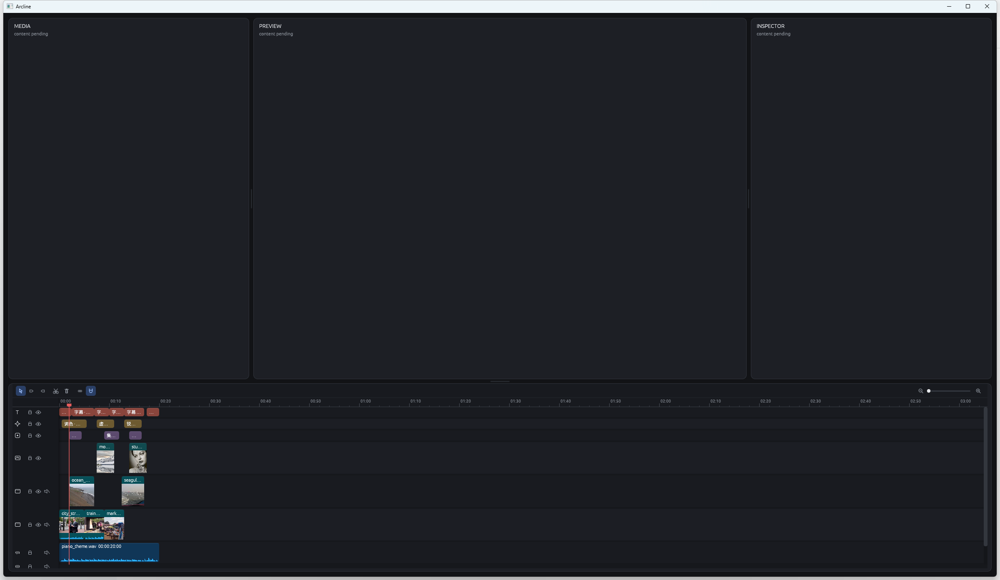
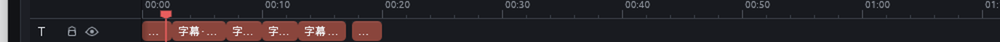
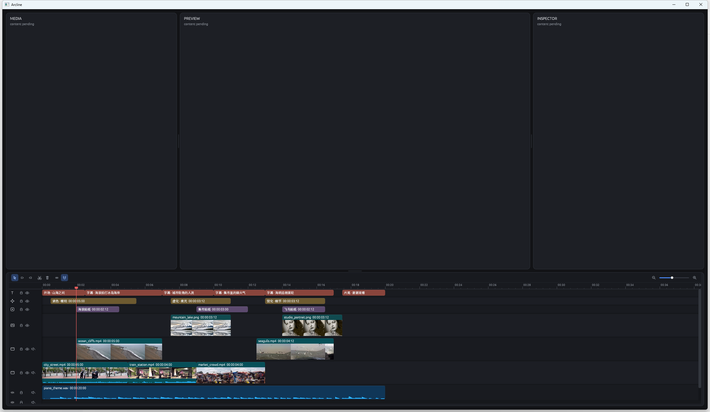
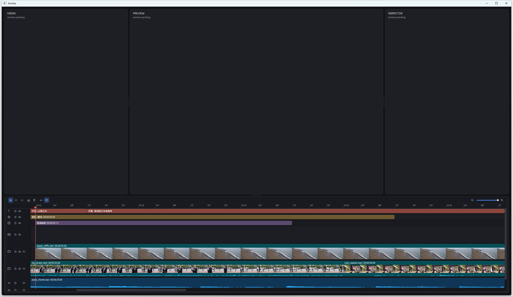
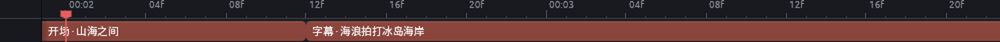
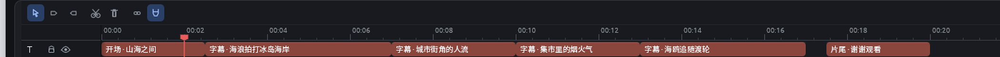
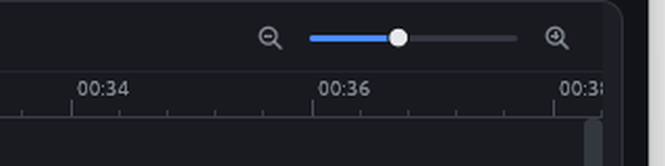
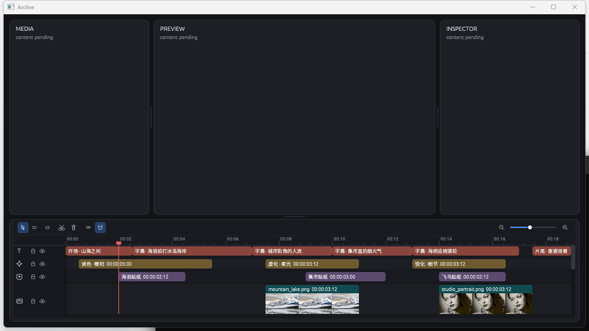

# Timeline Phase 2 — ruler, playhead and zoom (2026-11-27)

Base: `aaac024` (Phase 1 accepted). Scope: the timeline module and its card host only. The four-panel
layout, media pipeline, clip painters, track geometry and the rest of the editor are untouched.

## What changed

### 1. Time ruler

The ruler is now driven by one frame grid:

- `draw::FrameGrid { fps, nominal }` stores the real project rate and the nominal integer rate
  (`29.97 → 30`, `59.94 → 60`). Frame positions are always `frame / fps`, so non-integer rates are
  placed on real frame boundaries rather than rounded seconds.
- `draw::ruler_mode(px_per_sec, fps)` picks the scale:
  - **seconds** while whole-second labels fit, with 5 minor ticks between labels;
  - **frames** once a second can be split into frame labels. The frame step is the densest divisor
    of the nominal rate that keeps labels ≥ 78 pt apart.
- Labels:
  - whole seconds: `mm:ss` (`00:00`, `00:05`, `00:10`, `01:00`; `hh:mm:ss` past an hour);
  - frame ticks: `NNf`, numbered inside the nominal second (`08f`, `16f` at 24 fps; `10f`, `20f`
    at 29.97/30 fps).
- The ruler draws three tick levels: **9 pt** whole-second ticks, **6 pt** labelled frame ticks,
  **3 pt** individual-frame ticks (normal-zoom minor ticks stay at 4 pt).
- Labels are clipped to the ruler rect and spaced by `LABEL_GAP`, so they cannot overlap or spill
  into the card padding. The playhead handle sits in the lower 8 pt of the ruler so it cannot cover
  a label.
- No decimal-seconds format remains.

At the sample project's 24 fps the visible sequence is `00:02 → 04f → 08f → 12f → 16f → 20f →
00:03` when zoomed in, matching the reference mock's “24 FPS 示例”.

### 2. Playhead

- The handle and the vertical line still come from one `playhead_x` (`time_to_x`); the drag hit test
  uses its inverse (`x_to_time`).
- `drag_playhead` now snaps the clicked time to the nearest real project frame
  (`model::snap_to_frame`), so clicking and dragging are frame-accurate. The handle and line are
  recomputed from the snapped time in the same frame.
- The line spans the full lane body; the fixed control column is still painted above the canvas.
- Playhead colour is still red (`#E85D5D`).
- A new resize test re-renders the handle/line at 800×420, 1600×900 and 1000×500 and verifies they
  stay on the same time.

### 3. Zoom

- The `58 px/s` readout is gone. The toolbar's right side is `[−] [110 pt slider] [+]`.
- The slider is logarithmic over the existing 12–480 px/s range; the buttons keep ×0.8 / ×1.25.
- Mouse wheel still anchors at the pointer.
- Toolbar zoom now anchors on the **playhead's pixel** when it is visible; otherwise it falls back
  to the canvas centre. A unit test checks that the playhead does not move during a toolbar zoom.
- Scroll is clamped after every zoom, so the view cannot jump past the timeline ends.
- Only the horizontal scale changes; lane heights, clip heights and vertical scroll are untouched.
- Thumbnail and waveform density continue to follow the existing zoom-dependent tile/waveform
  logic; no painter was changed in this pass.

### 4. Visual chrome

- The card title is gone. `card_body` gives the timeline the card interior directly under the top
  border (10 pt side padding, 8 pt bottom padding), so the toolbar is the first row at the module
  top.
- Ticks use the existing low-key gray palette; the compact toolbar and dark theme are preserved.
- Chinese font fallback is unchanged.

## Preserved designs

Four-panel layout and fractions; fixed 112 pt left control column painted above the canvas; scrolling
canvas; content-derived track types and one-type-per-track rule; main/support/audio ordering; fixed
lane heights 24/76/50 pt; fixed clip heights 20/72/46 pt; no manual track resize; clip colours and
internal regions; real thumbnails, repeated images, embedded and standalone waveforms; asynchronous
media decode/caches; left-edge clip labels; empty-timeline state.

## Verification

| Check | Result |
| --- | --- |
| `cargo build -p arc-app` | success |
| `cargo test --workspace` | **204 passed, 0 failed, 2 ignored** (36 suites) |
| `cargo test -p arc-app` | **55 passed, 0 failed, 1 ignored** |
| `cargo clippy -p arc-app --all-targets` | completes; only the pre-existing warnings (empty mock toolbar branches, test `RawInput` assignment, `index % 2`) |
| Running app | `arcline` launched at 2400×1392 and at the 1280×720 default; screenshots below are real window captures |

New tests cover: `mm:ss` formatting; the seconds/frames switch; frame labels at 24/29.97/59.94 fps;
real frame positions for non-integer rates; frame snapping in the model; click-to-snap on the ruler;
playhead-pixel anchoring during toolbar zoom; window-resize mapping; cluster geometry and the
logarithmic slider.

## Screenshots

Low zoom (12 px/s): 10-second labels.

Medium zoom (58 px/s, the default): `00:00`, `00:02`, `00:04`, … and the playhead red line.

High zoom (480 px/s): frame ticks and the 24 fps `04f … 20f` grid.

Toolbar detail — first row of the module, zoom cluster on the right:

1280×720 default window (layout after a resize):

## Acceptance matrix

| # | Requirement | Evidence |
| --- | --- | --- |
| 1 | Low / medium / high ruler displays | 12 / 58 / 480 px/s captures; `ruler_mode` tests |
| 2 | Frame-level positioning accuracy | `non_integer_rates_place_frames_on_real_boundaries`; `playhead_snapping_uses_the_real_project_rate`; frame grid uses `frame / fps` |
| 3 | Click ruler and drag playhead | Existing click/drag tests; new `ruler_interaction_snaps_the_playhead_to_a_frame` |
| 4 | Handle and line stay in sync | `playhead_handle_and_line_share_one_x_across_scroll_and_zoom`; `dragging_the_playhead_moves_the_handle_and_the_line_in_the_same_frame`; one `playhead_x` |
| 5 | Scroll/zoom coordinate alignment | Scroll tests, zoom tests, `toolbar_zoom_keeps_the_playhead_pixel`, screenshots |
| 6 | Slider and zoom buttons | `toolbar_zoom_controls_change_the_zoom`, `the_zoom_slider_covers_the_whole_scale`; toolbar capture |
| 7 | Window resize behaviour | `resizing_keeps_the_playhead_mapped_to_its_time`; 1280×720 capture |
| 8 | Phase 1 media display not regressed | Workspace suite, unchanged media/clip painters, captures show thumbnails/images/waveforms |
| 9 | Non-integer rates (29.97 / 59.94) | `FrameGrid` unit tests: frame 30/60 at `30/29.97` and `60/59.94`; 10-frame ticks at those rates |
| 10 | No decimal-second primary labels | `ruler_timecode_seconds`; `ruler_labels_are_mmss_and_never_decimal_seconds`; captures |

## Unresolved / known limits

1. The running sample still uses `PROJECT_FPS = 24.0` from the mock timeline; the engine's project
   frame rate is not wired into this UI yet. The ruler/playhead code is rate-generic and unit-tested
   with 29.97/59.94, but there is no UI for selecting another rate in this phase.
2. Non-integer rates use **NDF-style** nominal-second labels (30/60 frames). Drop-frame timecode
   display is not part of this phase.
3. The ruler keeps drawing labels beyond the 20 s content end (existing timeline behaviour); only
   the playhead is clamped to the project duration.
4. The playhead handle is deliberately confined to the lower 8 pt of the ruler so it cannot cover
   tick labels. If the final visual language wants a full-height handle, a label-collision strategy
   is needed.

## Files changed

| Path | Change |
| --- | --- |
| `crates/arc-app/src/timeline/draw.rs` | `FrameGrid`, frame-index ruler, three tick levels, `mm:ss` labels, playhead handle placement |
| `crates/arc-app/src/timeline/mod.rs` | frame-snapped playhead, playhead-anchored toolbar zoom, lower-handle plumbing, tests |
| `crates/arc-app/src/timeline/model.rs` | `snap_to_frame`, frame-rate doc/tests |
| `crates/arc-app/src/shell.rs` | title-less `card_body` with the toolbar flush to the top border |
| `reports/screenshots/timeline-phase2-*.png` | Real running captures |
| `reports/timeline-phase2-2026-11-27.md` | This report |

## Commit

`d0ec44875f96e4ea5a8e61fb24068af120dc7e35` — `feat(timeline): phase 2 frame ruler, frame-accurate
playhead and playhead-anchored zoom`

Documentation and the report are in the follow-up docs commit.
