# Timeline Phase 2 supplement — full-range zoom, real FPS, thumbnails and waveforms (2026-11-27)

Branch: `feat/timeline-zoom-phase2b`, based on `d80779f`. Scope: the timeline module, its media
service, the shell card host and the app's project-rate load. No third-stage interaction features,
no engine commands, no layout or track-height changes.

## 1. Zoom range is derived from the real project frame rate

The previous 12–480 px/s ceiling is gone. The ceiling is now **200 logical px per project frame**:

| Project rate | Max zoom |
| --- | --- |
| 24 fps | 4 800 px/s |
| 25 fps | 5 000 px/s |
| 30 fps | 6 000 px/s |
| 29.97 fps (30000/1001) | 5 994.006 px/s |
| 59.94 fps (60000/1001) | 11 988.012 px/s |

`Timeline::max_zoom()` computes this from the exact `FrameRate`; the logarithmic slider, ± buttons and
Ctrl+wheel all clamp to it. The wheel still anchors on the pointer; the toolbar cluster anchors on the
visible playhead, falling back to the canvas centre. `zoom_at_pointer` is the one anchor formula used
by the wheel and its test. Horizontal zoom never touches lane/clip heights.

## 2. Ruler levels

The ruler is frame-index driven (`FrameGrid { rate: FrameRate, nominal }`); every position is
`FrameRate::time_of_frame(frame)` and never an accumulated float-second value.

| Zoom level | Ruler | Example at 30 fps |
| --- | --- | --- |
| Far overview | 5 s main ticks | `00:00`, `00:05`, `00:10` |
| Medium | 3 s main ticks | `00:00`, `00:03`, `00:06` |
| Fine | seconds + half-second frame tick | `00:02`, `15f`, `00:03` |
| High | 5-frame ticks | `00:02`, `05f`, `10f`, `15f`, `20f`, `25f`, `00:03` |
| Very high | 2-frame ticks | `00:02`, `02f`, `04f`, … `16f` |
| Extreme / 1f | one tick per frame | `00:02`, `01f`, `02f`, `03f`, … |

- 9 pt labelled whole-second ticks, 6 pt labelled frame ticks, 3 pt individual-frame ticks;
  normal-zoom minor ticks stay 4 pt.
- `LABEL_GAP = 78 pt` and a spacing test across 24/25/30/29.97/59.94 and 12–12 000 px/s proves labels
  cannot overlap.
- The frame step is a divisor of the nominal rate, so `mm:ss` stays on frame-aligned second
  boundaries and the grid never becomes uneven.
- 29.97/59.94 use nominal 30/60 labels (NDF) with real frame positions: frame 30 = 1.001 s at 29.97,
  frame 60 = 1.001 s at 59.94. Drop-frame display is deliberately out of scope.

## 3. Project frame rate is loaded, not hard-coded

- `TimelineModel` carries the exact `arc_core::time::FrameRate`.
- `App::new` opens `--project` with `arc_core::store::load_container` and builds
  `Shell::with_frame_rate(sequence.frame_rate())`; the running screenshots use a real 30 fps project
  (`Arcline — zoom-30`, clip durations read `00:00:02:15`, `00:00:03:15`).
- `Timeline::default()` remains 24 fps for the standalone mock; `--project` overrides it.
- No rounding to 30/60: snapping uses `FrameRate::frame_at` + `time_of_frame`; `29.97` → 30000/1001
  and `59.94` → 60000/1001 exactly.

## 4. Thumbnail density

The existing decoder workers, request deduplication and LRU texture cache are retained. The sampler
now steps by **project frames**, never by source frames:

- `thumbnail_step_frames(zoom, tile_px, project_fps) = ceil(tile_px / (zoom / project_fps))`.
- The step is always a whole number of project frames. At 30 fps/6 000 px/s (or 24 fps/4 800 px/s)
  the step is 1: one tile per project frame, 200 px wide.
- **Project rate is not source rate.** A 24 fps source in a 30 fps project contributes 24 distinct
  source frames per second; the six project frames without a new source frame legitimately repeat
  the previous source frame. The tile/cache logic does exactly that instead of fabricating different
  pictures or skipping project-frame slots.
- CFR cache keys use the **source frame index** (`FrameKey::Index`). Several project frames that
  resolve to the same source frame share one texture; a 30-tile second from a 24 fps source requests
  and caches 24 frames, not 30.
- `VideoDecoder::frame_displayed_at` returns the frame whose presentation interval contains the
  project time, using the **actual PTS** with only one container-tick tolerance (no half-frame
  rounding). It is used for thumbnail sampling; `frame_at` remains for compatibility/nearest use.
- At normal zoom the step is tens of project frames; at low zoom hundreds. Tile width stays near
  `thumb_height * 16/9`, so density rises continuously with zoom.
- Verified with generated counter videos:
  - a real encoded **30 fps counter fixture** at 320×180: every project frame decodes its own frame
    number and PTS (`counter == k`, `PTS == k/30`);
  - a **24 fps counter fixture in a 30 fps project**: exactly 24 distinct source frames per second,
    repeated project-frame hits, and 24 cached textures for 30 project tiles.
- VFR sources keep a requested-time key (`FrameKey::TimeUs`) and the decoder's actual PTS; VFR
  end-to-end verification remains backlog T1.
- Requests stay visible-area-only, deduplicated and bounded to `MAX_PENDING = 24` with 6 new
  requests per UI frame. Cache: 128 thumbnails × 320×180×4 ≈ **29.5 MB** texture budget.

## 5. Waveforms

`decode_peaks` still decodes audio once at 8 kHz (never whole-file re-decodes per paint) and now builds
three resolutions in that same pass: **4000 / 1000 / 200 peaks per second**. The painter selects the
coarsest level that is at least as dense as the current pixel density; extreme zoom falls back to
4000 pps. Silent ranges stay at zero and draw only the baseline.

- Standalone audio remains bright blue (`WAVE_BLUE`); embedded video audio is cyan-green
  (`WAVE_EMBEDDED`).
- Wave cache is capped at 6 files; a 20 s file is roughly 0.8 MB across all three levels, so the cache
  is bounded to a few MB rather than growing with zoom.
- Synthetic tests verify level selection, quiet/loud separation and flat silence; the real-media test
  verifies all three levels decode from the demo WAV and embedded AAC.

## 6. Preserved design

Four-panel layout; fixed 112 pt left column above the canvas; independent horizontal scroll and
vertical track scroll; content-derived track types and one type per track; main/support/audio order;
lane heights 24/76/50; clip heights 20/72/46; no manual lane resize; clip colours/regions; real
thumbnails/waveforms; left-edge clip labels; red playhead; unified `time_to_x`/`x_to_time`; empty
timeline state. No third-stage selection/hover/trim/drag/snapping work was added.

## 7. Tests and measurements

| Check | Result |
| --- | --- |
| `cargo build -p arc-app` | success |
| `cargo test --workspace` | **209 passed, 0 failed, 6 ignored** |
| `cargo test -p arc-app` | **60 passed, 0 failed, 5 ignored** |
| `cargo clippy -p arc-app --all-targets` | only the pre-existing workspace/UI warnings |
| 24-frame thumbnail benchmark (ignored) | **4.49 ms/frame** decode + 320×180 RGB(A) downscale |
| 3-level waveform build (18 s narration) | **12.3 ms**, **748,720 bytes**; levels 4000/1000/200 |
| 30 fps counter fixture (ignored) | every project frame decodes its own frame number and PTS |
| 24 fps in 30 fps fixture (ignored) | 24 distinct source frames, repeated project hits, 24 textures for 30 tiles |
| Extreme-zoom cache reuse (ignored) | 8 adjacent 24 fps frames ⇒ exactly 8 requests, 8 cached textures, no re-request |
| App memory at 1f, 2400×1392 | ~410–434 MB working set (includes wgpu, egui fonts, FFmpeg DLLs and the bounded caches) |

FPS tests cover 24, 25, 30, 30000/1001, 60000/1001: max zoom, tick labels, frame positions, snapping
and NDF clip timecodes. Interaction tests cover wheel-anchor math, toolbar-playhead anchor, ruler
click snapping, drag handle/line same-frame sync, scroll+zoom alignment and window resizing.

## 8. Actual screenshots (real 30 fps project)

Far overview, 5 s ticks:

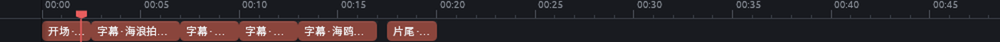

Medium, 3 s ticks:

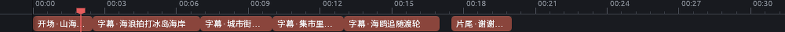

Fine, 15f ticks:

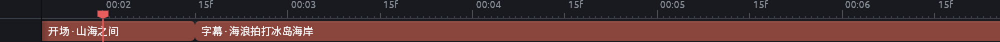

High, 5f ticks:

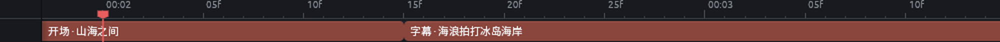

Very high, 2f ticks:

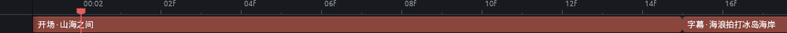

Extreme, 1f ticks and per-project-frame thumbnails:

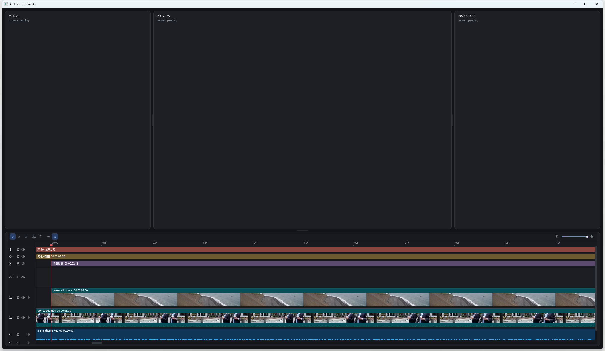

Ruler at 1f:

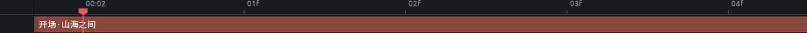

Project-frame thumbnails at 1f (the 24 fps demo source legitimately repeats source frames in the
30 fps project; tiles are 200 px, aligned with the 1f ruler):

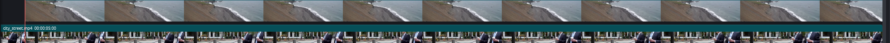

Waveform detail at 1f (cyan-green embedded video audio above, blue standalone audio below):

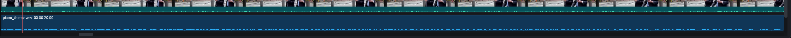

Default 30 fps timeline and toolbar:

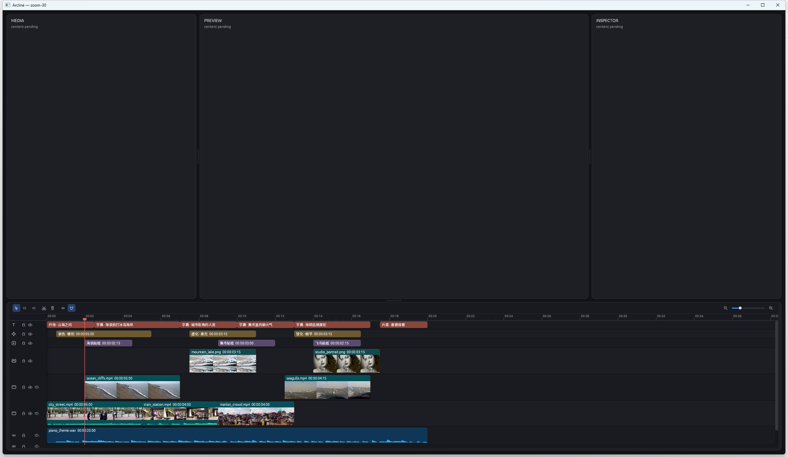

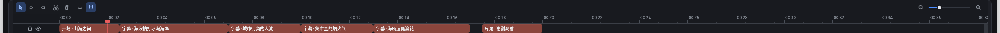

## 9. Acceptance matrix

| # | Requirement | Evidence |
| --- | --- | --- |
| 1 | 5 s / 3 s / 15f / 5f / 2f / 1f levels | `ruler_levels_follow_zoom_and_project_rate`; six captures |
| 2 | Adaptive intervals, no hard-coded spacing | `ruler_mode` uses `LABEL_GAP` + rate divisors; spacing test |
| 3 | Major/minor/frame tick hierarchy | 9/6/3 pt tick heights; ruler crops |
| 4 | Labels never overlap | `ruler_labels_never_overlap_across_rates_and_zooms` |
| 5 | No jitter/uneven grid | all positions from one frame grid; `time_of_frame` |
| 6 | Zoom max from real FPS | `max_zoom_scales_with_the_project_frame_rate` |
| 7 | 200 px/frame target | 24→4800, 30→6000, 59.94→11988 |
| 8 | Log slider + buttons + wheel | geometry/mapping tests; toolbar capture |
| 9 | Pointer / playhead anchors do not drift | `wheel_zoom_keeps_the_time_under_the_pointer`, `toolbar_zoom_keeps_the_playhead_pixel` |
| 10 | Zoom independent of track height | `horizontal_zoom_does_not_change_track_heights` (now includes max) |
| 11 | Thumbnail density changes with zoom | `thumbnail_tiles_step_by_whole_project_frames`; captures |
| 12 | One tile per project frame at extreme | 1f capture; 30 fps counter fixture |
| 13 | Project 30 fps ≠ source 30 fps | 24 fps-in-30 fps counter test: 24 distinct source PTS, repeated project hits, 24 textures for 30 tiles |
| 14 | No fake repeated frames / correct PTS | `frame_displayed_at`; counter index + PTS assertions |
| 15 | Async, visible-first, deduplicated, bounded | existing workers + pending cap + source-frame keys |
| 16 | Waveform levels and detail | 4000/1000/200 levels; `level_for_px`; captures |
| 17 | Real audio, no simulated samples | `decode_peaks`; real-media ignored test |
| 18 | Blue standalone / cyan-green embedded | `WAVE_BLUE` / `WAVE_EMBEDDED`; waveform crop |
| 19 | Silence flat | `waveform_picks_a_resolution_for_the_zoom_and_keeps_silence_flat` |
| 20 | Real project frame rate | `App::new` loads `--project`; 30 fps capture shows 30 fps clip labels |
| 21 | 24/25/30/29.97/59.94 tests | `ruler_levels…`, `max_zoom…`, `playhead_snapping…`, `non_integer…` |
| 22 | Preserve accepted design | no layout/height/painter changes; workspace suite |

## 10. Unresolved / limits

1. **VFR is supported by the decoder, not proven by a VFR fixture.** `VideoDecoder::frame_displayed_at`
   returns the actual PTS and `ThumbVisual` carries it, but the repository has no VFR test asset; VFR
   tiles use a requested-time key and the stream's reported average rate for spacing. Tracked as
   **T1** in [the technical backlog](../docs/timeline-technical-backlog.md).
2. **NDF only.** As requested, 29.97/59.94 use NDF `mm:ss` labels; drop-frame timecode is not added.
3. **The app still repaints continuously** (`request_redraw` after every frame, pre-existing). This
   keeps CPU busy at idle even though the media caches settle; tracked as **T2**.
4. The source frame rate is read by opening the decoder header on the UI thread once per path; no
   frame is decoded there. Tracked as **T3**.
5. Audio decoding remains capped at 120 s per file (existing limit), and ruler labels still extend
   past the 20 s sample content (existing behaviour).

## 11. Files changed

| Path | Change |
| --- | --- |
| `crates/arc-app/src/timeline/model.rs` | exact `FrameRate`, snapping, max-frame target |
| `crates/arc-app/src/timeline/mod.rs` | dynamic max zoom, playhead/pointer anchors, frame-index thumbnail plan, waveform colors, tests |
| `crates/arc-app/src/timeline/draw.rs` | frame-rate ruler, 5s/3s/15f/5f/2f/1f levels, tick heights, NDF timecode |
| `crates/arc-app/src/timeline/media.rs` | project-frame tile step, source-frame cache keys, `frame_displayed_at` sampling, source metadata, 3-level waveforms, bounded caches, benchmarks |
| `crates/arc-media/src/libav.rs` | `frame_displayed_at` (actual PTS, no half-frame rounding) |
| `crates/arc-app/src/shell.rs` | `Shell::with_frame_rate` |
| `crates/arc-app/src/app.rs` | load the real sequence rate from `--project` |
| `docs/timeline-technical-backlog.md` | T1 VFR verification, T2 idle repaint, T3 header probing |
| `reports/screenshots/timeline-phase2b-*.png` | Real 30 fps captures and detail crops |
| `reports/timeline-phase2b-zoom-2026-11-27.md` | This report |

## 12. Commit

- `19b0f3b71a005f6a66de2917709785be661cbdd2` — `feat(timeline): full-range zoom, real project fps and media detail`
- `6b6d4eb3fb68a20b61598663c936ff6fa622df12` — `fix(timeline): map project-frame thumbnails to real source PTS`

Documentation, the technical backlog and this report follow in the docs commit. Branch:
`feat/timeline-zoom-phase2b`.
