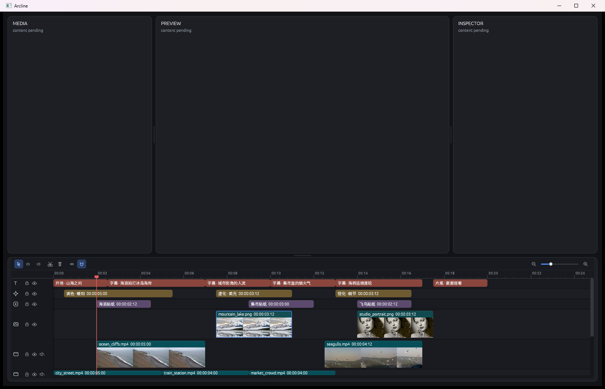
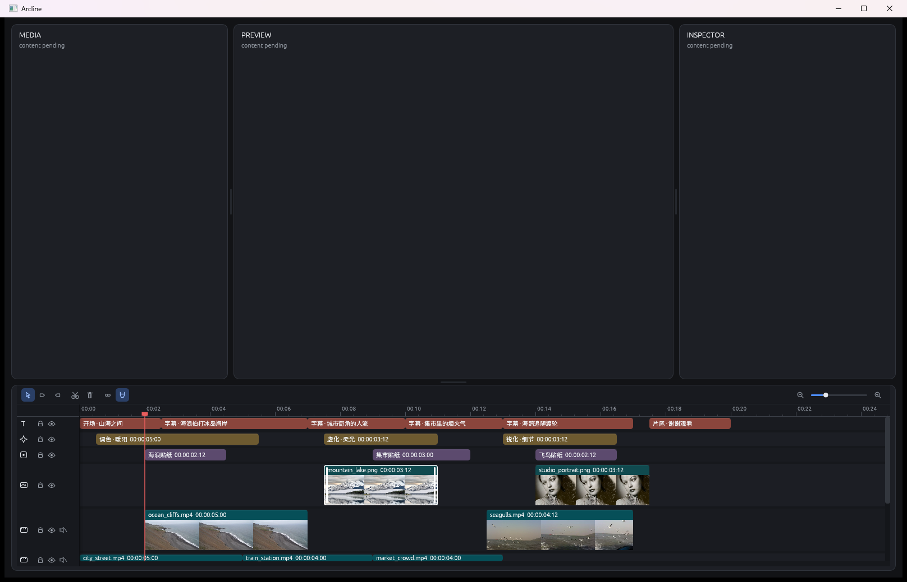
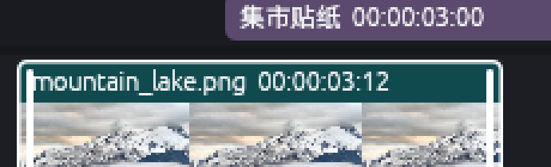
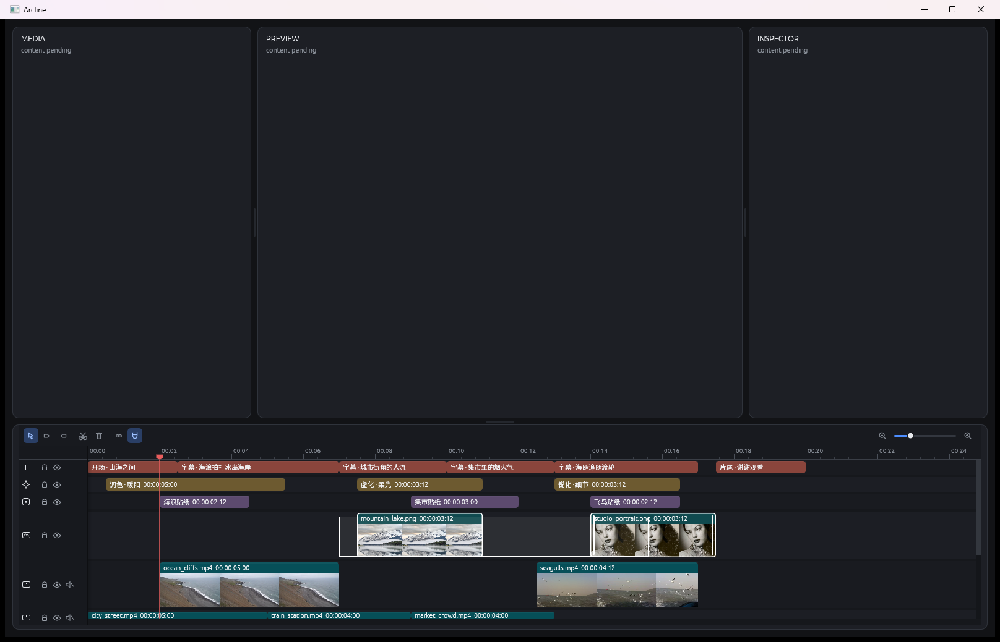
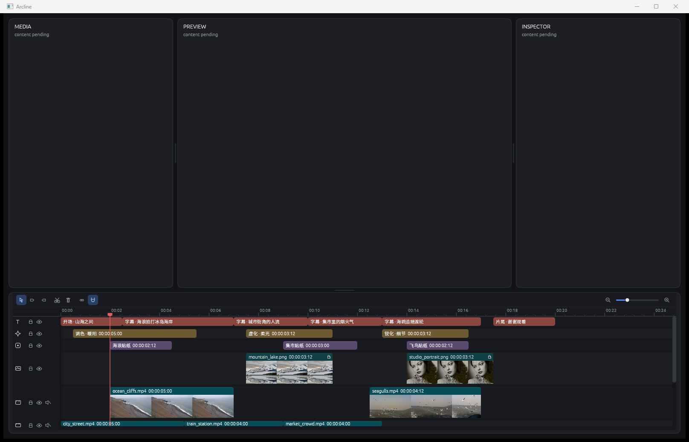
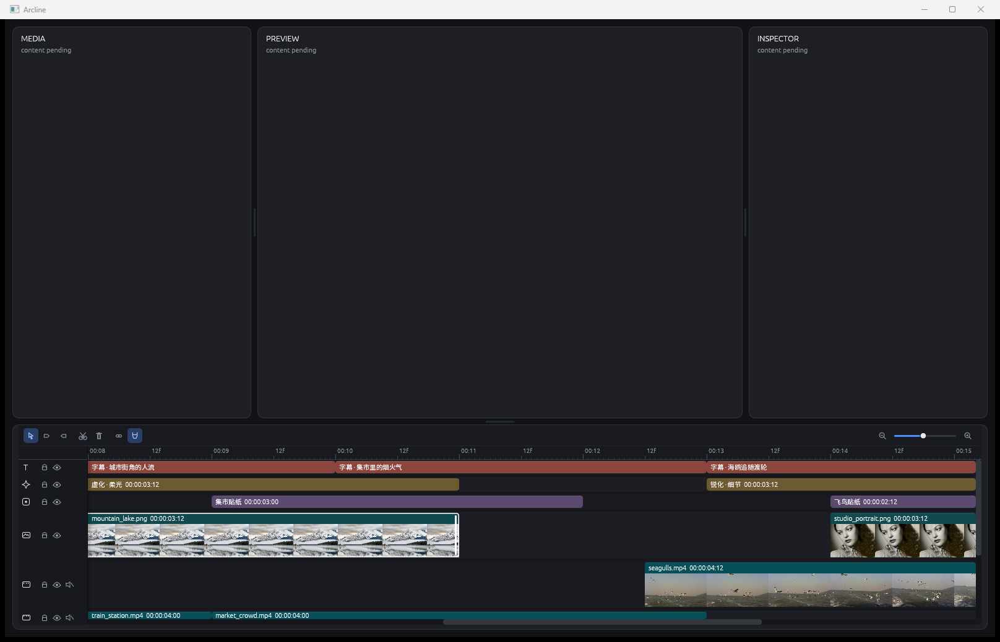
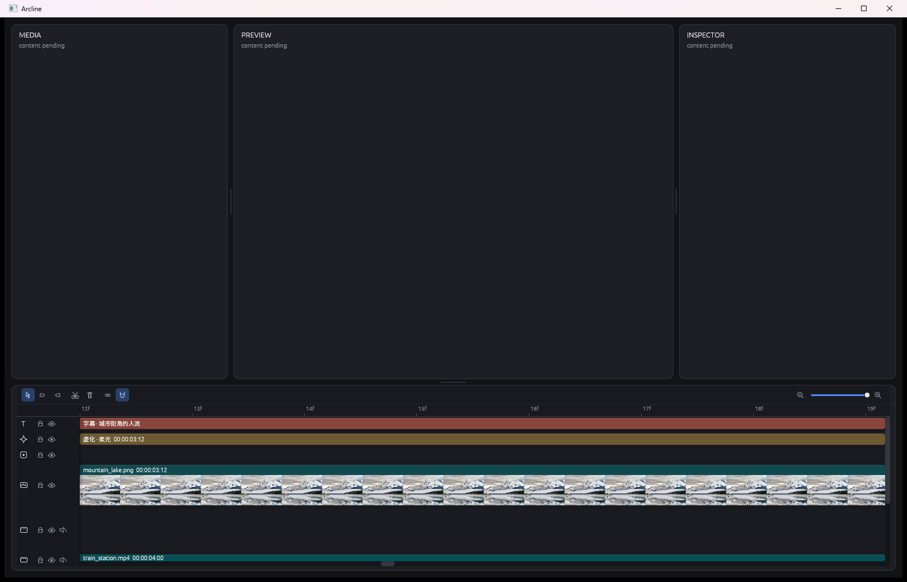

# Timeline Phase 3A — 素材交互状态（悬停 / 选择 / 框选）

**分支：** `feat/timeline-zoom-phase2b`  
**状态：** Phase 3A 完成，等待视觉验收。  
**范围：** 只做状态与交互视觉；不做实际移动、裁剪、分割、吸附、工程修改；不做音量线/淡入淡出（3B）；不改已验收布局。

---

## 1. 实现内容

### 1.1 选择模型

- 新增 `timeline/interaction.rs`：`ClipRef`、`Selection`、`ClipGeometry`、`ClipHit`、`HitZone`、`Marquee`。
- `Selection` 是 `BTreeSet<ClipRef>` + `primary`；primary 是最后加入的选中项。
- 普通点击单选；Ctrl/Cmd 点击切换；点击空白清空；Esc 清空/取消框选。
- 多选中点击已选项收敛为单选；点击锁定 clip 不改变选择。
- 所有选中 clip 统一 **1.5 pt 白色边框**；只有 primary 显示左右裁剪手柄。

### 1.2 命中与几何

一个 `clip_geometry()` 同时供绘制与命中使用：

- Video：header 18 / thumb 38（无音频时 54）/ embedded audio 16；
- Image：header 18 / image 54；
- Audio：header 16 / wave 30；
- Text / Effect / Sticker：整块 20 pt。
- 左右 trim 命中为真实边缘向内 6 pt；可见宽 <20 pt 时 4 pt，<12 pt 隐藏。
- trim 只存在于真实 clip 边缘：视口边缘、固定列下、滚动条下不会产生假手柄。
- 选中/hover 边框绘制真实 clip 矩形并按内容区裁剪，不画在 `visible` 交集上。
- 部分超出视口：标签仍贴可见左边缘；真实边缘在视口外时不画、不命中 handle。

### 1.3 Hover

- 主体：内侧 1.5 pt accent hover 边框 + 4% 白色 overlay；cursor 保持 `Default`。
- 左右真实边缘：2 pt 竖条 ghost handle；cursor `ResizeHorizontal`。
- 选中 primary：3 pt 白色手柄，内缩 4 pt，和 1.5 pt 白边框明确区分。
- 音频区域：只做 9 alpha 白色提亮；3B 前不显示音量线或淡入淡出手柄。
- 锁定：无 trim、无选择，cursor `NotAllowed`，锁图标 + 8% veil。
- 隐藏轨道：整条 clip 不绘制、不命中；与“禁用 clip”分离。
- 禁用 clip：仍绘制但整体压暗（`from_black_alpha(150)`），不参与 hover/选择/框选。
- 静音：只覆盖 audio/wave 区域（`from_black_alpha(115)`）+ mute 图标；视频画面、选择、trim 不变。

### 1.4 框选

- 空白 lane 左键拖动开始框选；默认替换选择，Shift/Ctrl/Cmd 追加。
- 框选矩形裁剪到画布内容区，填充 18 alpha 白、1 pt 白边框。
- 只选中与框选矩形相交的可见 clip；锁定/隐藏/禁用排除。
- 不做反选、不做自动滚动；Esc 取消并恢复框选前选择。

### 1.5 状态组合

状态按 overlay 组合，而不是互斥枚举：

- `Selected + Hover`：白色选中边框 + body hover overlay；primary 手柄保留。
- `Selected + Muted`：白色边框 + audio 区压暗/静音图标。
- `Hover + Muted`：audio 提亮 + 静音压暗同时存在。
- `Locked / Disabled` 覆盖交互；隐藏轨道在绘制前跳过。

---

## 2. 实际运行截图

全部为 1616×1039 的实际 Arcline 窗口截图（1600×1000 client）。

普通态：

悬停（图片 clip）：

单选（白色边框 + 左右手柄）：

单选手柄放大：

多选（两个图片 clip，仅第二个 primary 有手柄）：

框选（框选矩形 + 两个命中 clip）：

锁定（图片轨道锁定，clip 显示锁图标，无选择/手柄）：

部分遮挡（真实左边缘在视口外，不产生假左边框/左手柄）：

极限缩放（1f 标尺，图片按 project frame 重复，边缘仍为真实边缘）：

> 截图使用临时 debug state hook 摆好状态；hook 在最终提交前已移除，生产代码只由真实指针事件产生这些状态。

---

## 3. 测试结果

| 命令 | 结果 |
|---|---|
| `cargo test -p arc-app` | **73 passed**, 0 failed, 9 ignored |
| `cargo test -p arc-cli --test preview` | 17 passed（T1 回归，未受 3A 影响） |
| `cargo test -p arc-cli --test render_e2e` | 6 passed（T1 回归，未受 3A 影响） |
| `cargo check -p arc-app` | 通过，无 warning |

新增覆盖：

- `ctrl_click_adds_and_plain_click_collapses_the_selection`
- `locked_hidden_and_disabled_clips_are_not_selectable`
- `marquee_selects_a_region_and_escape_clears`
- `additive_marquee_keeps_the_existing_selection`
- `hover_distinguishes_body_and_real_edges_but_not_viewport_edges`
- `selection_is_pruned_when_a_track_becomes_locked_or_hidden`
- `interaction` 单测：区域尺寸、trim 窄化、真实边缘、框选裁剪、primary 切换。

旧测试全部保留：布局、轨道高度、缩放、缩略图、波形、播放头、滚动、固定列。

---

## 4. 验收对照

| 要求 | 结果 |
|---|---|
| 普通态保持现有视觉 | 未选中/未 hover 时不加边框、不改 body |
| 悬停 | body / 真实边缘 / audio 区分别反馈 |
| 单选 | 白色 1.5 pt 边框 + primary 左右手柄 |
| 多选 | Ctrl/Cmd；全部白框；仅 primary 手柄 |
| 框选 | 默认替换，Shift/Ctrl 追加；Esc 取消 |
| 取消选中 | 空白点击 / Esc / Ctrl 再点 |
| 白色边框 | 所有选中项统一 1.5 pt 白色 |
| 裁剪手柄 | 仅 primary，左右真实边缘，内缩 4 pt |
| 光标 | 边缘 `ResizeHorizontal`，主体 `Default`，锁定 `NotAllowed` |
| 锁定 | 不可选、不可编辑、无手柄，锁图标 + `NotAllowed` |
| 隐藏 vs 禁用 | 隐藏轨道不绘制；禁用 clip 仍绘制但压暗且不可交互 |
| 静音 | 只影响 audio/wave 区域，不影响视频画面/选择/trim |
| 部分超出视口 | 真实边缘才绘制/命中；无假边框/假手柄 |
| 极限缩放 | 1f 标尺、缩略图正确；固定屏幕尺寸手柄不漂移 |
| 状态组合 | Selected + Hover + Muted 可叠加 |
| 不改布局 | 轨道高度、工具栏、标尺、缩略图、波形、播放头未改 |
| 不做实际编辑 | 无移动/裁剪/分割/吸附/工程命令 |

---

## 5. 已知边界 / 后续

1. **3B 未做：** 音量线、fade-in/out 菱形手柄、音频专用交互均未出现，避免虚假 gain/fade 值。
2. **trim 仅视觉：** 光标和手柄已显示，但不执行裁剪；实际 drag 留给第 4 阶段。
3. **框选不做自动滚动/反选**（按确认范围）。
4. **锁定/禁用不提供右键菜单或状态提示条**；仅视觉 + 光标。
5. **Muted** 对视频的 embedded audio 和独立音频 clip 生效；无音频视频不显示静音控件。
6. 截图使用临时 debug hook 摆放状态，hook 已移除；生产输入路径有单元测试覆盖。
7. 未重跑完整 workspace，只做 arc-app 与 T1 的 preview/render 回归。

---

## 6. 文件

- `crates/arc-app/src/timeline/interaction.rs` — 新增选择/几何/命中/框选。
- `crates/arc-app/src/timeline/mod.rs` — 输入、绘制、状态组合、测试。
- `crates/arc-app/src/timeline/draw.rs` — 白框、trim、锁/静音图标、框选。
- `crates/arc-app/src/timeline/model.rs` — `Clip.enabled`（禁用与隐藏分离）。
- `docs/timeline-phase3-interaction-design.md` — Phase 3A 实现差异注释。
- `reports/screenshots/p3a-*.png` — 实际运行截图。
- `reports/timeline-phase3a-interaction-2026-11-28.md` — 本报告。
