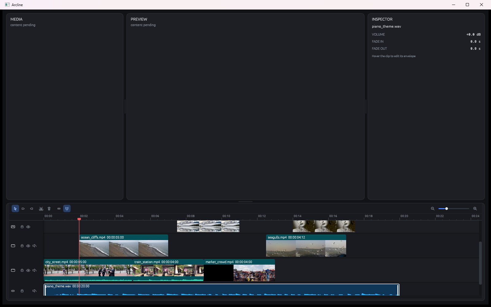
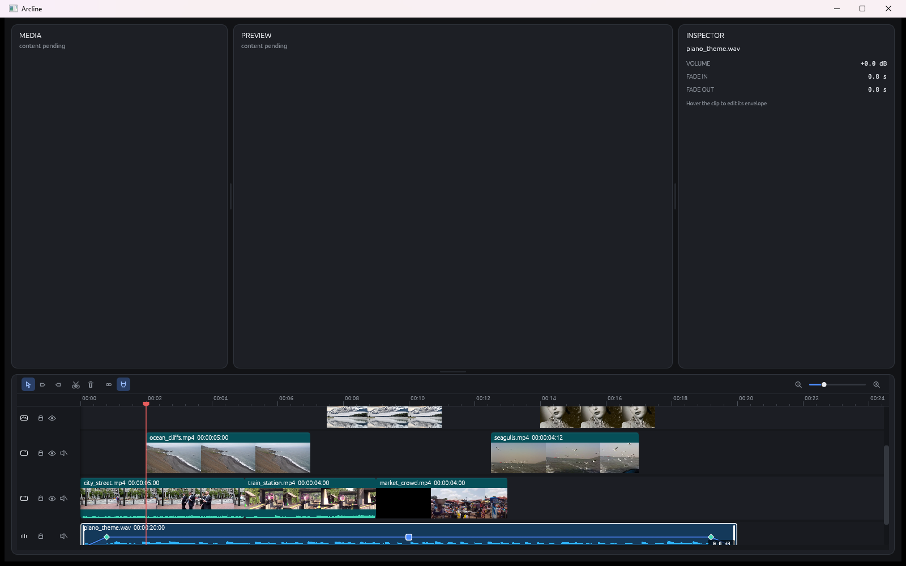
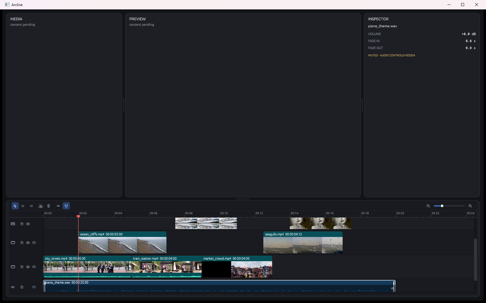
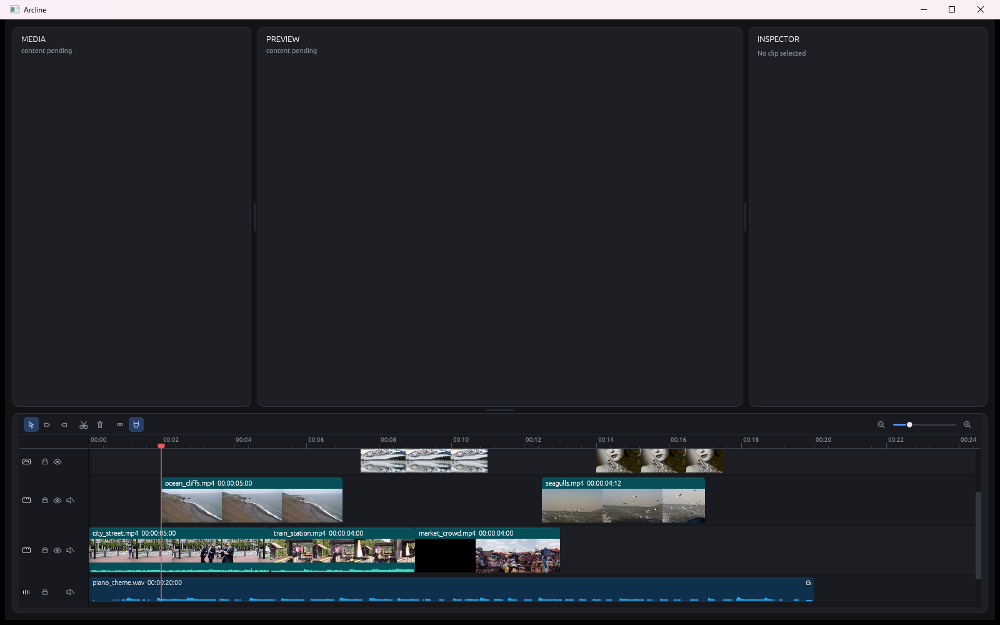
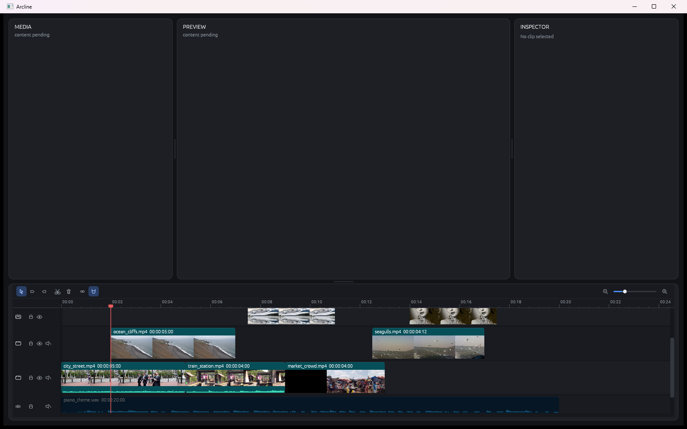
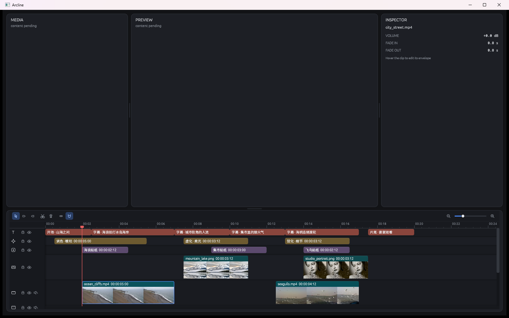
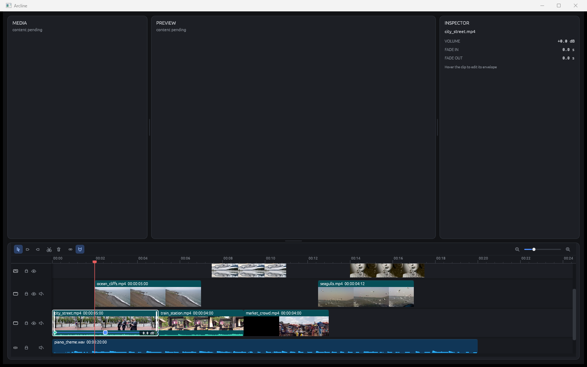

# Timeline Phase 3B — Audio Interaction

**Date:** 2026-11-28
**Branch:** `feat/timeline-zoom-phase2b`
**Status:** implementation complete for the C4 timeline surface; waiting for visual acceptance.
**Design record:** [timeline-phase3b-audio-design.md](../docs/timeline-phase3b-audio-design.md)

## 1. Result

Phase 3B adds Arcline-owned volume and fade controls to the timeline. The controls use the existing
`arc_core::model::ClipAudio` value type and the existing `arc-audio` mixer / `arc-cli` export path.
The visual language is not a copy of the reference: blue haloed curve, white directional chevron
level node, teal diamond duration nodes, translucent fade wedges and a compact lower-right dB chip.

## 2. Interaction implemented

| Gesture | Result |
|---|---|
| Hover an audio-capable clip | Envelope, volume node, fade diamonds appear |
| Move away | Controls disappear; clip returns to normal |
| Click the clip body | Selects the clip; only the Phase 3A white outline |
| Drag volume node or line vertically | `gain_db` changes in `[-60, +12]`; Inspector and readout update |
| Drag left diamond | `fade_in` duration changes; ramp starts at the clip's real left edge |
| Drag right diamond | `fade_out` duration changes; ramp ends at the clip's real right edge |
| Escape during a gesture | Restores the pre-drag `ClipAudio` |
| Ctrl/Cmd+Z | Undoes the last audio gesture |
| Ctrl/Cmd+Shift+Z or Ctrl+Y | Redoes it |
| Locked / muted / disabled | No controls; mute dims only the audio region; lock/disable remain distinct |

The waveform is scaled by gain and by the fade envelope. It is not shortened or clipped by a fade.
The volume node is a pure-white directional chevron (see the chevron report below); the fade
diamonds, envelope, Inspector, model and engine path are unchanged. The controls are painted, not
widget-per-clip; hover does not request decoding or a second waveform.

## 3. Screenshots (actual running app, 1600 × 1000)

> These captures predate the 2026-11-28 chevron adjustment. The current volume node is the white
> directional chevron documented in
> [timeline-phase3b-chevron-2026-11-28.md](timeline-phase3b-chevron-2026-11-28.md); the rest of the
> states are unchanged.

Normal — no selection, no audio chrome:

Hover, unselected — envelope and nodes, no white outline:

Selected — Phase 3A outline only; Inspector shows the values:

Selected + hover — outline and envelope compose:

Volume drag — `+6.0 dB`, taller waveform, node/line moved:

Fade in + fade out — both diamonds and both ramps, Inspector `0.8 s / 0.8 s`:

Muted — only the audio region is dimmed and badged; controls hidden:

Locked — no selection or controls:

Disabled — full clip veil, no controls:

Video with embedded audio — selected border surrounds the whole video; controls live in the bottom
16 pt audio strip; Inspector reads the video's `ClipAudio`:

The same video with the audio strip controls visible:

> The screenshots were taken from the real app with a temporary `ARCLINE_CAPTURE_STATE` pose so the
> requested states were stable while capturing. That hook has been removed. The video-controls frame
> used a forced hover pose; the actual hit priority is covered by the geometry tests.

## 4. Test results

| Command | Result |
|---|---|
| `cargo test -p arc-app` | **82 passed**, 0 failed, 9 ignored |
| `cargo test -p arc-audio` | **3 passed** (`positions_gain_pan_fades_speed`, parity, WAV writer) |
| `cargo test -p arc-cli --test preview` | **17 passed** (T1 regression) |
| `cargo test -p arc-cli --test render_e2e` | **6 passed** (T1 regression) |
| `cargo check -p arc-app` | pass, no warnings |

New `arc-app` tests:

- volume node drag updates gain and undo/redo;
- the white chevron rotates above/below the audio-region centre;
- left and right diamond drags set fade-in/fade-out;
- muted, locked and disabled clips cannot be edited;
- the geometry works at 29/58/116 px/s;
- a video with embedded audio exposes the same controls;
- gain/fade mapping, node hit zones and local history.

The existing `arc-audio` test `positions_gain_pan_fades_speed` proves that the same
`ClipAudio::gain_db`, `fade_in` and `fade_out` fields change mixed samples. The exporter already
uses that mixer once per export, so preview/export parameter semantics are shared at the engine
layer.

## 5. Demo steps

1. Hover the `piano_theme.wav` clip: the blue curve and three nodes appear.
2. Drag the white chevron up: Inspector moves from `+0.0 dB` toward `+6.0 dB`; waveform grows and
   the chevron rotates with the node.
3. Drag the left diamond right: `FADE IN` becomes non-zero; the left ramp grows.
4. Drag the right diamond left: `FADE OUT` becomes non-zero; the right ramp grows.
5. Press Ctrl+Z twice: the fade and volume changes return in order.
6. Select the video clip with audio and hover its bottom strip: the same controls appear without a
   second track or thumbnail occlusion.

## 6. Acceptance matrix

| # | Requirement | Status |
|---|---|---|
| 1 | Volume adjustment | Pass |
| 2 | Fade-in adjustment | Pass |
| 3 | Fade-out adjustment | Pass |
| 4 | Control-node hit testing | Pass |
| 5 | Real-time parameter feedback | Pass (Inspector + chip) |
| 6 | Undo/redo | Pass for the C4 surface (local gesture history) |
| 7 | Standalone audio | Pass |
| 8 | Video embedded audio | Pass (geometry + Inspector + screenshot) |
| 9 | Muted / locked / disabled | Pass |
| 10 | Playback and export consistency | **Partial:** the mixer/export path consumes the same `ClipAudio`; the C4 timeline is not yet bound to a live `Project`/`Engine` |
| 11 | Different zoom levels | Pass (29/58/116 test) |
| 12 | Normal + selected visual regression | Pass (3A 81-test suite) |

## 7. Important boundary

The app's timeline is still the C4 presentation model described in the Phase 3A report. It does not
load timeline clips from `arc_core::model::Project`; `--project` currently supplies only the sequence
rate. Therefore:

- the audio parameters and waveform are real values, not display-only fakes;
- the local `AudioHistory` is a C4 gesture stack, not the engine's project history;
- the engine already accepts `audio.set_gain` and `audio.set_fades` commands and its mixer/export
  path already reads the same parameters;
- wiring the C4 timeline to a live project snapshot and emitting those commands is **not** part of
  this commit.

This is recorded explicitly rather than presented as a completed engine integration. The next
integration step is to map timeline clip references to project `ClipId`s and route gestures through
`Engine::apply`, at which point the local history should be removed.

## 8. Files

- `crates/arc-app/src/timeline/audio.rs` — new envelope geometry, controls, hit zones, local history
  and their unit tests
- `crates/arc-app/src/timeline/mod.rs` — audio gesture input, undo/redo keys, drawing, Inspector
- `crates/arc-app/src/timeline/draw.rs` — gain/fade-scaled waveform
- `crates/arc-app/src/timeline/interaction.rs` — audio zones and real-edge hit priority
- `crates/arc-app/src/timeline/model.rs` — `ClipAudio` on each timeline clip
- `crates/arc-app/src/shell.rs` — Inspector content
- `docs/timeline-phase3b-audio-design.md`
- `reports/screenshots/p3b-*.png`
- `HANDOVER.md`, `.gitignore`

No Phase 3C, T2/T3, zero-copy, move/trim/split/snap, keyframe UI, or main merge is included.
