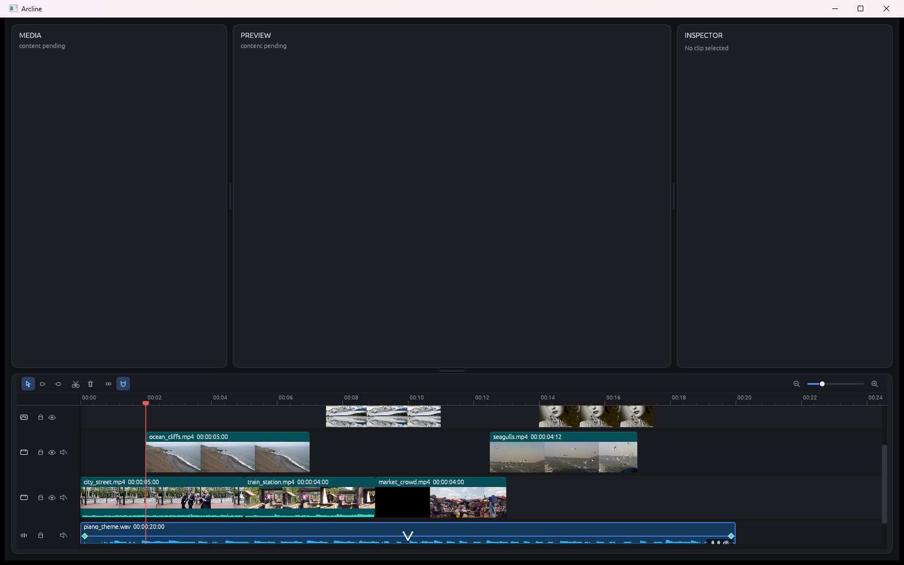
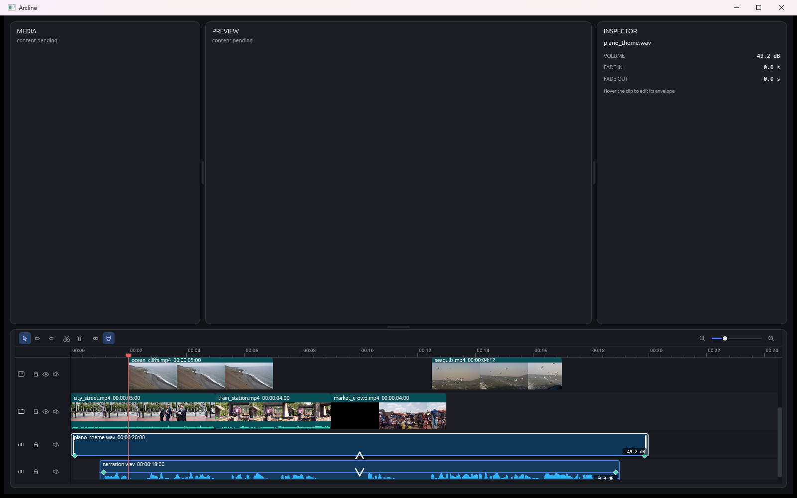

# Timeline Phase 3B — Volume Node Chevron Adjustment

**Date:** 2026-11-28
**Scope:** visual-only change to the volume control node.
**Branch:** `feat/timeline-zoom-phase2b`

## 1. Change

The blue rounded-square volume node is replaced by a pure-white `>` chevron, rotated by 90°:

- node above the audio-region centre → tip **down** (`∨`);
- node below the audio-region centre → tip **up** (`∧`);
- 16 × 14 pt visual, two 2 pt rounded strokes, 18 × 18 pt hit box;
- no base, fill, shadow or glow; the white strokes float directly on the blue envelope;
- hover/drag uses a 2.4 pt stroke for a brighter, easier-to-grab read.

The fade diamonds, envelope curve, Inspector, dB range, model, undo/redo and engine path are
unchanged.

## 2. Screenshots (actual running app, 1600 × 1000)

Arrow above centre, tip down:

Arrow below centre, tip up (`-30.0 dB`):

Mouse drag (`-49.2 dB`, active stroke; the Inspector updates live):

The screenshots were taken from the real app with a temporary capture-state pose to set the scroll
and low-gain state; the drag frame is a real mouse-down capture. The temporary hook has been
removed.

## 3. Tests

| Command | Result |
|---|---|
| `cargo test -p arc-app` | **82 passed**, 0 failed, 9 ignored |

The new unit test checks both directions across the audio-region centre and the 18 pt hit box.
Existing volume drag, fade drag, hit priority, undo/redo, mute/lock/disable and zoom tests still
pass.

## 4. Files

- `crates/arc-app/src/timeline/audio.rs` — chevron drawing, direction, 18 pt node
- `crates/arc-app/src/timeline/mod.rs` — passes drag activity to the draw call
- `docs/timeline-phase3b-audio-design.md` — design record updated
- `reports/screenshots/p3b-chevron-*.png`

No Engine, Mixer, Export, Phase 3A, fade-node, Inspector, data-model or undo/redo changes.
