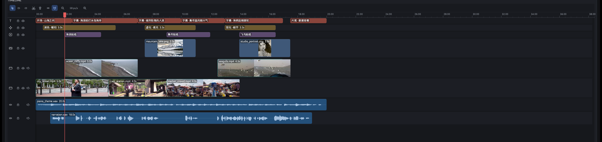
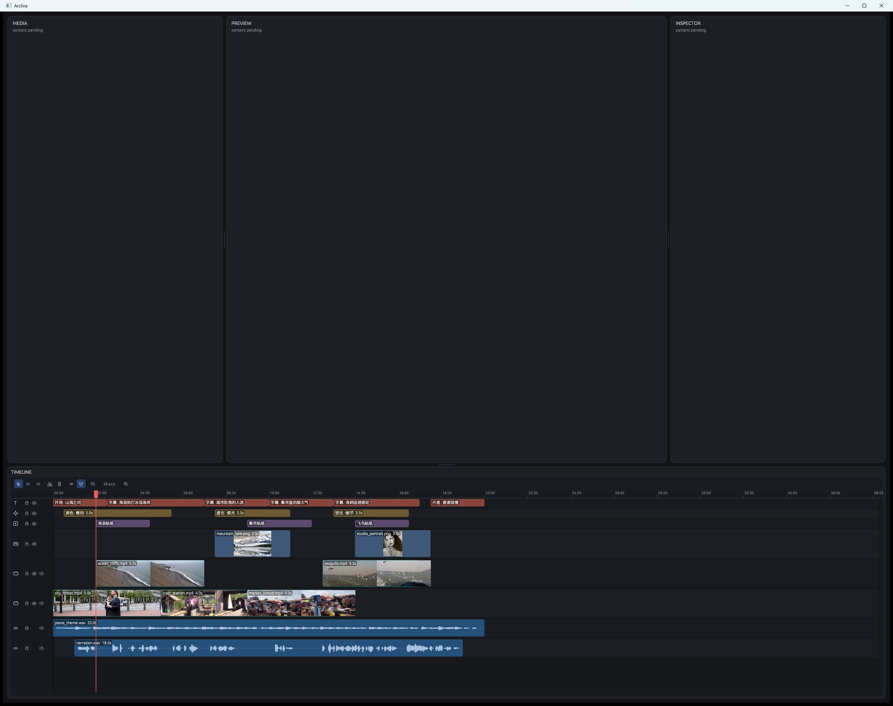
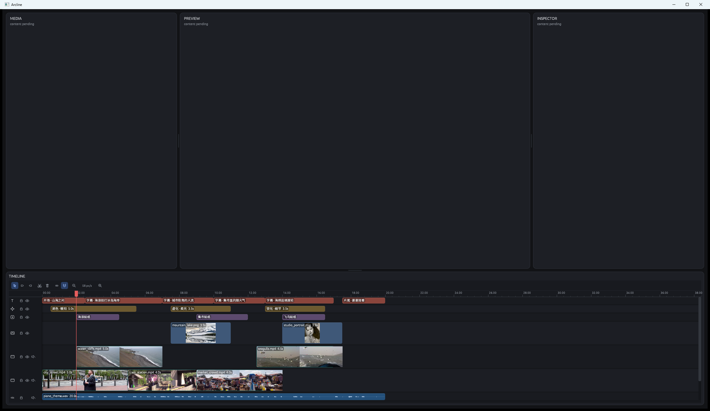
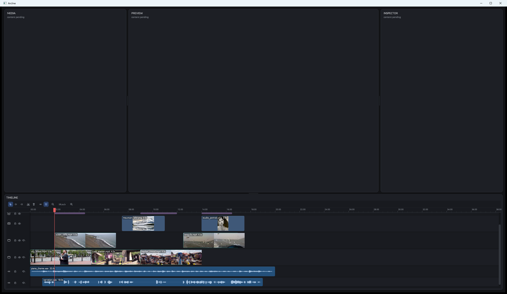

# Timeline sample project — real-world media (2026-11-26)

Replaced the synthetic Mandelbrot / SAPI demo set with real, publicly licensed footage, photographs,
music and a human voice recording. The sample project now exercises every existing clip painter
with actual decoded content. No layout, track-height, left-panel or playhead code was changed.

## What the sample project contains

The built-in `TimelineModel::mock()` project (20 s, 58 px/s, playhead at 2 s) has the same eight
lanes and the same 428 pt content height as before:

| Lane | Kind | Clips |
| --- | --- | --- |
| Text / subtitles | Text | 开场 · 山海之间; 字幕 · 海浪拍打冰岛海岸; 字幕 · 城市街角的人流; 字幕 · 集市里的烟火气; 字幕 · 海鸥追随渡轮; 片尾 · 谢谢观看 |
| Effects | Effect | 调色 · 暖阳; 虚化 · 柔光; 锐化 · 细节 |
| Stickers | Sticker | 海浪贴纸; 集市贴纸; 飞鸟贴纸 |
| Images | Image | `mountain_lake.png` (landscape); `studio_portrait.png` (portrait) |
| B-roll | Video | `ocean_cliffs.mp4`; `seagulls.mp4` |
| Main video | Video | `city_street.mp4`; `train_station.mp4`; `market_crowd.mp4` |
| Music | Audio | `piano_theme.wav` (20 s) |
| Narration | Audio | `narration.wav` (18 s, human voice) |

Five distinct real videos are used across the main and supporting video tracks. The complete
provenance, authors, licences, durations, sizes and SHA-256 values are in
[`assets/demo/README.md`](../assets/demo/README.md).

## Media sources (short form)

| Content | Source | Licence |
| --- | --- | --- |
| People: Market Street, San Francisco | Wikimedia Commons, JanGerber | CC BY-SA 3.0 |
| People: Tamale market | Wikimedia Commons, Salifu Wumpini Hussein | CC BY-SA 4.0 |
| Landscape: ocean cliffs, Iceland | Wikimedia Commons, Alexander Grebenkov | CC BY 3.0 |
| Moving object: MBTA train | Wikimedia Commons, Beantowndude316 | CC BY 2.0 |
| Moving objects: seagulls behind a ferry | Wikimedia Commons, Subhashish Panigrahi | CC BY-SA 3.0 |
| Landscape photograph: Maligne Lake | Wikimedia Commons, Sergey Pesterev | CC BY-SA 4.0 |
| Portrait photograph: Acquanetta, 1944 | Wikimedia Commons, Universal Pictures / Ray Jones | Public domain |
| Background music: piano | Wikimedia Commons, Clavier Music (Pixabay) | CC0 1.0 |
| Human voice narration | LibriVox *Winnie-the-Pooh* cast reading, narrator Lynette Caulkins | Public domain |

No Mandelbrot renders, test patterns, generated images or synthesised speech remain in
`assets/demo`. The videos are real 24 fps H.264 files (640×360); the stills are real PNG images
(1280×854 and 1200×1600); both audio files are real 44.1 kHz PCM recordings.

## Chinese text

The timeline's labels render Chinese because `install_cjk_font()` adds
`assets/fonts/NotoSansSC-Arcline.ttf` as the last fallback for egui's proportional and monospace
families. The font is a 580-character subset of Noto Sans SC (weight 400, 138,400 bytes) licensed
under the SIL OFL 1.1; its internal family is renamed `Arcline CJK` and the copyright notice plus
full licence are in `assets/fonts/OFL.txt`. Latin text still comes from egui's bundled fonts.

## Evidence

Timeline detail, cropped from the full-window capture below. All eight lanes are visible: Chinese
titles and subtitles, effects, stickers, both photographs, the two B-roll clips, the three main
video clips, the music waveform and the narration waveform:

The full window at a size large enough for all eight lanes (captured with `PrintWindow` after the
window was sized past the physical screen):

Top of the timeline in a normal 2400×1392 window:

Scrolled to the main video and both audio tracks:

The decoded waveforms differ by source: `piano_theme.wav` shows a continuous musical envelope, and
`narration.wav` shows distinct speech bursts and pauses. The video lanes show different decoded
frames per tile (people, train, market, waves, birds), and the two image lanes preserve landscape
and portrait aspect ratios.

## Acceptance matrix

| # | Requirement | Evidence |
| --- | --- | --- |
| 1 | 3–5 real video clips with people, landscapes and moving objects | Five files: `city_street.mp4`, `market_crowd.mp4` (people); `ocean_cliffs.mp4` (landscape); `train_station.mp4`, `seagulls.mp4` (moving objects). Screenshots show decoded frames. |
| 2 | Real photographs, landscape and portrait | `mountain_lake.png` 1280×854 landscape; `studio_portrait.png` 1200×1600 portrait; both show in the Images lane. |
| 3 | Background music | `piano_theme.wav`, a real 20 s piano recording; waveform visible in the Music lane. |
| 4 | Human voice narration | `narration.wav`, LibriVox human reading; waveform shows speech bursts in the Narration lane. |
| 5 | Text and subtitle clips containing Chinese characters | Six Chinese clips on the text lane; screenshot shows the rendered glyphs, not boxes. |
| 6 | Effects and sticker clips | Three effect clips and three sticker clips with Chinese names. |
| 7 | Assets arranged on main/supporting/audio tracks | Main video has three clips, B-roll two, Images two, Music and Narration below; visual tracks remain above the main video. |
| 8 | Actual decoded video thumbnails and audio waveforms | `paint_video` / `paint_image` / `paint_audio` unchanged and read the new files; screenshots show decoded content. `real_demo_media_decodes` decodes a frame, a still and the narration envelope. |
| 9 | No synthetic or artificial media | `assets/demo/README.md` lists the real Commons sources; the old Mandelbrot/SAPI generator was replaced. |
| 10 | Preserve layout, track heights, left-panel layering, playhead sync | No changes to `layout()`, `draw.rs`, `control_panel()`, lane heights or the playhead mapping. Track heights remain 24/24/24/76/76/76/50/50; content height stays 428 pt. Existing layout/playhead tests still pass. |
| 11 | No new features or core architecture changes | Changes are data, assets, a font fallback, and test expectations only. No engine, document or command code touched. |

## Verification

- `cargo build -p arc-app` → finished successfully.
- `cargo test --workspace` → exit 0; **189 passed, 0 failed, 2 ignored**.
- `cargo test -p arc-app real_demo_media_decodes -- --ignored` → **1 passed** (decodes
  `city_street.mp4`, `mountain_lake.png` and the `narration.wav` envelope).
- `cargo test -p arc-app` → 40 passed, 1 ignored.
- `ffprobe` on every asset is recorded in `assets/demo/README.md`; all files decode, the photos are
  1280×854 and 1200×1600, the videos are 640×360 H.264 at 24 fps, and the audio is 44.1 kHz mono
  PCM.

## Files changed

| Path | Change |
| --- | --- |
| `assets/demo/*` | Removed the synthetic set; added five real MP4 clips, two real PNG photographs, piano music and a human narration WAV. |
| `assets/demo/README.md` | Rewritten: content, timeline placement, provenance, licences, preparation, hashes, verification. |
| `assets/fonts/NotoSansSC-Arcline.ttf`, `OFL.txt` | New CJK fallback subset and its OFL licence. |
| `crates/arc-app/src/app.rs` | `install_cjk_font()` after creating the egui context. |
| `crates/arc-app/src/timeline/model.rs` | Sample project content and real source paths; tests updated. |
| `crates/arc-app/src/timeline/media.rs` | Ignored integration test now decodes the new assets; de-duplication test path. |
| `scripts/demo-media.ps1` | Replaced the Mandelbrot/SAPI generator with a download-and-encode script for the real sources. |

## Notes

- The still decoder handled JPEG with an "end of stream" error on this libav build, so the two
  photographs are stored as PNG. Their pixels are unchanged real photographs.
- The CJK font is a subset built for this sample's 580 characters. If the sample text changes, the
  subset must be rebuilt; Latin text is unaffected.
- The whole-timeline screenshot uses a window taller than the 2560×1440 screen and `PrintWindow`,
  because fixed lane heights and the current panel fraction need roughly 1900 px to show all eight
  lanes at the host's DPI scaling. The normal and scrolled captures fit the screen.
