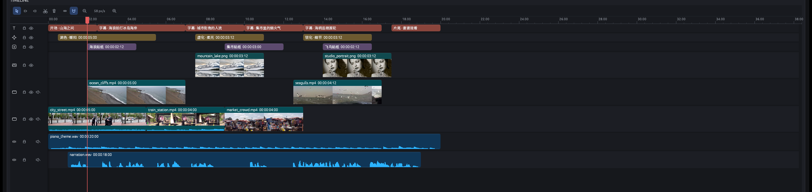
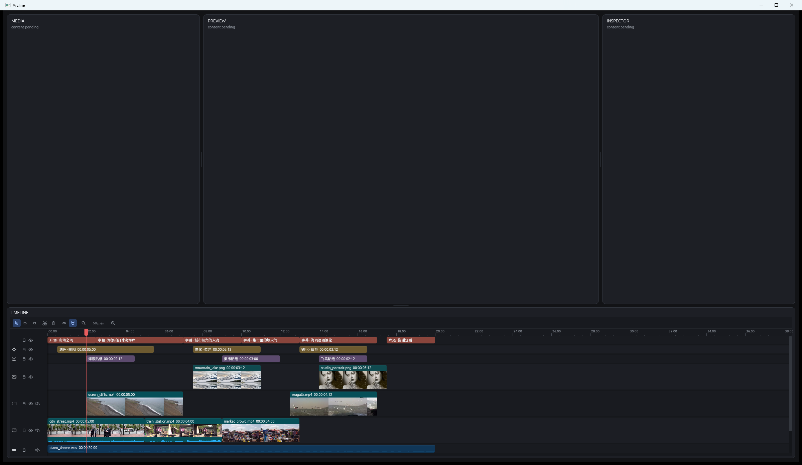
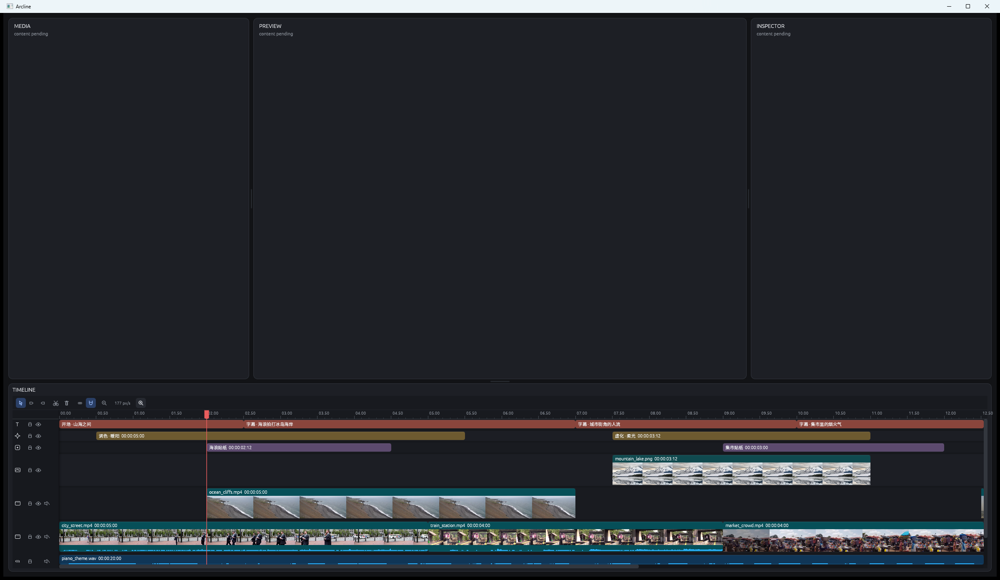
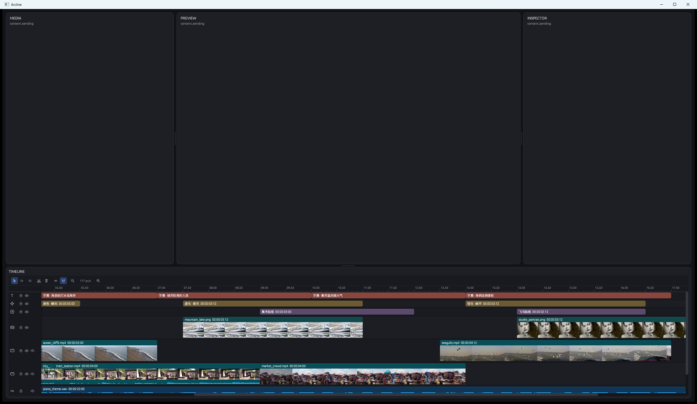

# Timeline clip visual refinement (2026-11-26)

Refined the internal appearance of every timeline clip using the existing real-media sample project.
The four-panel shell, fixed control column, scrolling canvas, track heights, clip heights, dynamic
track typing and playhead mapping are unchanged.

## Internal clip layout

| Clip | Height | Regions |
| --- | --- | --- |
| Video (with audio) | 72 pt | 18 pt header, 38 pt continuous thumbnails, 16 pt embedded audio waveform |
| Video (silent) | 72 pt | 18 pt header, 54 pt continuous thumbnails (no empty audio strip) |
| Image | 72 pt | 18 pt header, 54 pt repeated image strip |
| Audio | 46 pt | 16 pt header, 30 pt bottom-anchored waveform |
| Text / Effect / Sticker | 20 pt | full-height centred text |

Video and image clips use the dark teal family; audio clips use dark blue. Headers are the clip
background itself — no separate dark label rectangle, and no text is drawn over thumbnails.

### Video

`city_street.mp4` and `train_station.mp4` now keep their original ambient audio (mono 44.1 kHz AAC),
so the embedded waveform strip is exercised with real decoded audio. `market_crowd.mp4`,
`ocean_cliffs.mp4` and `seagulls.mp4` are silent and use the full 54 pt thumbnail region.

Thumbnails are decoded frames tiled from source timestamps. Each tile is centre-cropped with
`uv_fill`, so the tile row has no gaps and no distortion. The tile step still comes from the existing
zoom-dependent ladder, and the embedded waveform uses the same decoded envelope cache as audio
clips.

### Image

The decoded still is repeated horizontally in 72 pt tiles. Every tile preserves the source aspect
through `uv_fill` (centre crop), so landscape and portrait photographs fill the region without
stretching or large empty areas.

### Audio

The waveform is drawn as thin, dense, bright-blue bars growing upward from a single bottom baseline.
The bar height is the absolute envelope peak of the source-time range covered by that screen column;
silence stays flat and loud passages stand tall. The source-time aggregation follows the timeline
zoom, and the existing 200 peaks/second envelope cache is reused.

### Text, effect and sticker

The existing muted red/brown, amber and purple backgrounds are kept. Labels are drawn directly on
the clip background, vertically centred, with no dark label box behind them. Names are elided when
the clip is too narrow.

## Labels and timecode

- All clip labels use one typography: 10.5 pt, 6 pt horizontal padding, left alignment, vertical
  centring, no background.
- Media, effect and sticker labels show the name and `HH:MM:SS:FF` duration on one line where space
  permits. Text clips show their content name.
- Durations use the sample project's 24 fps timebase: `5.0 s` reads `00:00:05:00`, `4.5 s` reads
  `00:00:04:12`. No decimal durations remain in timeline labels.
- The label rect is the clip header (or the whole 20 pt text clip) intersected with the content area
  right of the fixed control column. When a clip scrolls left, its label stays at the clip's
  leftmost visible edge; it is clipped to that rect, so it cannot overlap a neighbour or draw under
  the control column.
- The selection outline is painted after clip content, so thumbnails and repeated images cannot
  cover it.

## Screenshots

Timeline detail, cropped from the full-height capture (all eight lanes):

Full application window at 2400×1392:

Zoomed to 177 px/s (labels and thumbnail density at a wider time scale):

Horizontally scrolled to around 5 s (labels remain at the left visible edge and off the control
column):

## Acceptance matrix

| # | Requirement | Evidence |
| --- | --- | --- |
| 1 | Video 72 pt, 18 header / 38 thumbnails / 16 embedded waveform | `city_street.mp4` and `train_station.mp4` show all three regions; `internal_clip_regions_fill_the_approved_heights`; screenshots. |
| 2 | Dark teal video background, dedicated header, no text over thumbnails | Header text is drawn only in the 18 pt strip; screenshots show thumbnails below it. |
| 3 | Thumbnails fill the region without gaps or distortion | Tiles are contiguous and centre-cropped via `uv_fill`; zoomed and scrolled screenshots show a continuous strip. |
| 4 | Embedded waveform only when source has audio; silent videos use remaining height | `city_street`/`train_station` have AAC audio and a 16 pt strip; `market_crowd`/`ocean_cliffs`/`seagulls` are silent and use 54 pt thumbnails. `MediaHub::has_audio` caches the stream check; `real_demo_media_decodes` decodes the embedded AAC envelope. |
| 5 | Thumbnails/waveforms correspond to actual source timestamps | Existing `(path, source millisecond)` thumbnail keys and source-time envelope lookups are unchanged; screenshots show different decoded frames per tile. |
| 6 | Image 72 pt with 18 pt header and 54 pt repeated image, proportions preserved | `mountain_lake.png` and `studio_portrait.png` repeat across their lanes; `uv_fill` crop keeps aspect, no stretch. |
| 7 | Audio 46 pt, 16 header / 30 waveform; dark blue; thin bright-blue upward bars; real amplitude; silent flat; zoom density; cached envelope | Screenshots show the bottom-up bars; `draw_waveform_bars` aggregates per painted column; quiet/loud narration and continuous music differ; the existing `Waveform` cache is reused. |
| 8 | Text/effect/sticker 20 pt, correct colours, actual name, vertically centred, no label background | Labels are drawn directly on the muted red/amber/purple clip bodies; screenshots show no dark label boxes. |
| 9 | Consistent labels, HH:MM:SS:FF, no decimals, clipped, leftmost visible edge, no panel overlap | `clip_label`, `timecode_hhmmssff`, `clip_label_rect`; `clip_labels_use_frame_timecode_without_decimals`, `clip_labels_stick_to_the_visible_left_edge_and_off_the_panel`; scrolled screenshot. |
| 10 | Preserve layout, fixed panel, scrolling canvas, heights, spacing, types, playhead, decoding/caching, Chinese font, empty timeline | No changes to `layout()`, `control_panel()`, lane heights (24/76/50), clip heights (20/72/46), track validation or playhead mapping. Existing 44 app tests pass, including playhead and fixed-column tests. |
| 11 | No new features/architecture, no Phase 2, other panels untouched | Changes are limited to timeline drawing/regions, clip colours, the cached audio-presence check, sample video audio, docs and tests. |

## Tests and build

- `cargo build -p arc-app` → success.
- `cargo test --workspace` → **193 passed, 0 failed, 2 ignored**.
- `cargo test -p arc-app real_demo_media_decodes -- --ignored` → **1 passed** (decodes a video frame,
  the PNG still, the narration envelope, the embedded `city_street.mp4` AAC envelope, and verifies
  `has_audio` is true for `city_street.mp4` and false for `market_crowd.mp4`).
- `cargo clippy -p arc-app --all-targets` completes; remaining warnings are pre-existing workspace
  warnings (empty toolbar branches, `% 2`, etc.), none in the new clip-region/waveform/label code.
- `scripts/demo-media.ps1` re-ran into a temporary directory and reproduced byte-identical files:
  `city_street.mp4` `13c85c3f…`, `train_station.mp4` `baf603b4…`, and the unchanged silent clips,
  images and audio. The asset table in `assets/demo/README.md` has the current hashes.

## Modified files

| Path | Change |
| --- | --- |
| `crates/arc-app/src/timeline/draw.rs` | Region constants, plain label rendering, bottom-up waveform bars, `HH:MM:SS:FF` timecode, selection outline helper. |
| `crates/arc-app/src/timeline/mod.rs` | Per-kind internal regions, tiled video/image painting, embedded video waveform, audio waveform region, label placement/clipping, tests. |
| `crates/arc-app/src/timeline/media.rs` | Cached `has_audio` stream check; ignored test covers embedded AAC and silent video detection. |
| `crates/arc-app/src/timeline/model.rs` | Dark-teal/dark-blue clip colours and the sample project's 24 fps constant. |
| `assets/demo/city_street.mp4`, `train_station.mp4` | Re-encoded with their real ambient AAC audio; still 640×360 H.264 24 fps. |
| `assets/demo/README.md` | Updated asset sizes/hashes, embedded-audio notes and verification. |
| `scripts/demo-media.ps1` | Two main clips keep AAC audio; the other three remain video-only; robust argument array. |
| `reports/screenshots/refined-*.png` | Final visual evidence. |

## Commit

`<commit>`
